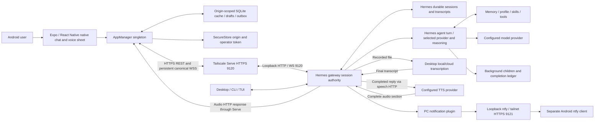
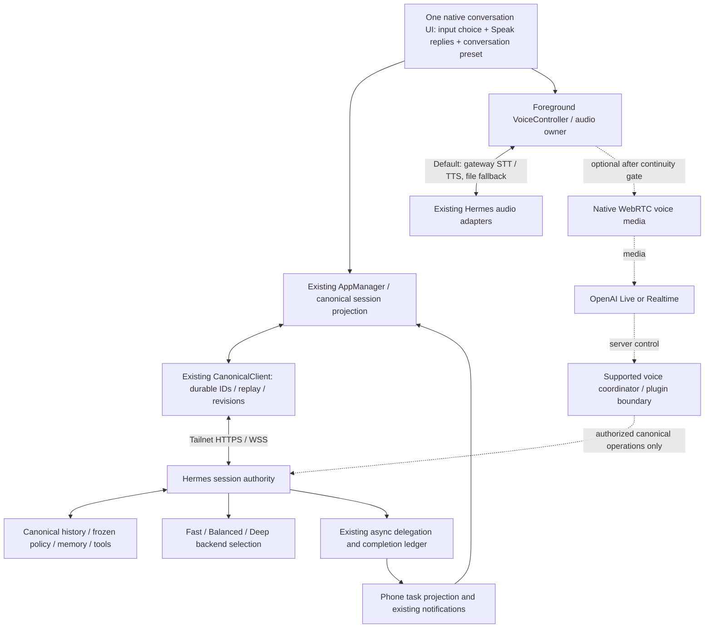
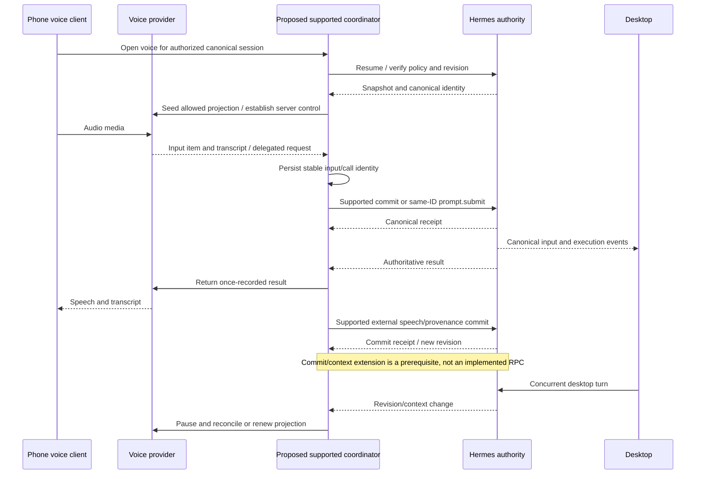
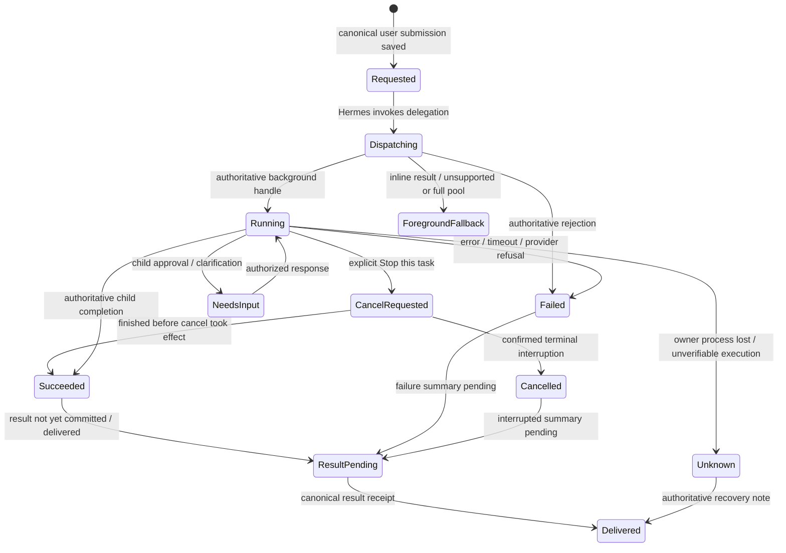

# Hermes Android conversational experience: architecture and implementation proposal

**Date:** 17 November 2026, Australia/Sydney  
**Status:** Implementation authorized in the subsequent conversation; first Phase 0 diagnostic candidate implemented, independently reviewed and repaired. Baseline commit/progression authorized on 18 November 2026; see [execution record](docs/plans/conversational-experience-execution.md). Original research and future-phase conditions below remain applicable.  
**Scope:** Planning only. Preserve ongoing audit repairs, existing shared Hermes sessions, memory, tools, skills, desktop handoff and operator approval boundaries.  
**Baseline:** Mobile HEAD `8d509633857594d82431528d374cf0cfae645c97` **plus a moving, extensively modified working tree**; installed Hermes source `ea1d78596e7ddd51daf228311cb37e033fd2686c`. See the [evidence inventory](docs/plans/2026-11-17-conversational-experience-evidence.md) for exact sources, versions, source/runtime distinctions and investigation limits.

This is an investigation and reviewable proposal, not a replacement for the governing [PLAN](PLAN.md), an accepted ADR, or approval to begin its implementation. The task explicitly authorizes saving planning documents before implementation review. No application source, runtime configuration, dependencies, existing documentation or live session was changed for this investigation. No new inference, audio job, live benchmark or background agent was run.

**Concurrent-work update:** while this investigation was running, the other work updated [STATUS](docs/STATUS.md) and the [0.3.1 release record](docs/releases/0.3.1.md) to report the audit-repair candidate built and installed successfully. Its phone behavior acceptance remains open. This plan includes those repaired working-tree sources, rather than requesting the old audit defects be fixed again. The reported build/install/tests belong to that separate work; this investigation did not perform them.

**Confirmed owner constraint, subsequent clarification:** use the existing OpenAI Pro subscription, its included usage and the **existing included API credits the owner has confirmed are available**. The owner is happy to consume those credits but requires staying within the free allowance. **No new paid plans, subscription upgrades, purchased credits, additional payment methods, Auto Recharge or usage beyond included credit allowance.** This is a hard execution constraint, not a future request to approve extra spend. Credit amounts, balance, billing-cycle expiry and organization-level paid fallbacks have not been inspected here. Sections 14.0 and 16 define the no-overrun gate. Any separately priced alternatives below remain research comparisons unless covered by the existing allowance; omit them if that cannot be established. No API calls or billing changes were made in response to this clarification.

**Account-setup clarification:** a subsequent authenticated, read-only gateway `GET /api/audio/voice-live/status` returned HTTP 200 with `mode: chained` and `available: false`: the running default-profile gateway cannot currently resolve the API credential its GPT-Live path requires. No provider request, inference, session creation or credential change was made. **The recommended existing-pipeline phases need no new API-account connection.** A later optional native voice API implementation would require a server-side API credential for the owner's existing credit-backed organization, plus the allowance controls; it does not require phone account sign-in, a new subscription or a new paid plan. Credential presence elsewhere and account credit/billing details were not inspected.

## 1. Executive summary

**Recommend a staged A+B approach: improve the existing Hermes pipeline and add simple conversation presets using existing session mutations.** Keep Hermes as the only persistent conversation and execution authority. Retain the current native app, canonical client, durable outbox, replay recovery and voice ownership machinery. These foundations already solve much of the requested continuity problem.

The application is not missing text streaming, model switching, voice input, TTS, hands-free mode or shared desktop sessions. It already has them. The main confirmed architectural delay for voice is serial processing: finish recording, transcribe the entire file, run an ordinary Hermes turn, wait for its matching final response, synthesize a section, load and play it. Short first sections and one-section prefetch already exist. Those optimizations must not be proposed as new work.

The saved synthetic diagnostic reports 1.195 s STT, 1.643 s first text and 2.197 s final reply from submit, and 1.217 s synthesis for a separate 320-character sample. With the current 1.3 s hands-free endpoint, an illustrative sum is **about 5.9 s after the user's last voiced sample**, before handset/native overhead. This combines separately measured stages and is **not a measured phone result**. It explains why 1–2 s cannot be promised from the present pipeline. Actual desktop slowness still needs attribution; it cannot be caused solely by Android or Tailscale.

The current profile already selects the relatively efficient `gpt-6-luna`, but uses `medium` reasoning. The first model experiment should therefore compare the **same model/session policy at none/low/medium**, with quality and tool/memory checks, before buying complexity through another conversational model. These settings have not been changed or benchmarked here.

Installed Hermes provides additional reusable capabilities: streaming STT/TTS routes, asynchronous top-level delegation, subagent controls, and a separate GPT-Live integration. Their existence does not prove they are exposed to this phone or meet canonical history guarantees. In particular:

- The STT stream is opt-in and the current local STT path is not a live streaming provider.
- The speech stream can reduce post-completion audio startup, but cannot decide whether provisional text is safe to speak.
- GPT-Live already delegates to Hermes while retaining the selected backend model, yet its current Desktop path does not canonically commit every spoken exchange. Reusing it unchanged fails this brief's continuity requirement.
- Async delegation can keep a parent responsive, but capacity/unsupported-delivery fallbacks can run inline. Restart recovery of completed results does not resume running children.

**Longer-term target:** optional native voice, preferably reusing a supported upstream integration, only after a canonical external-turn commit/context contract is established. OpenAI Realtime and GPT-Live are evaluated separately in section 6. Neither is assumed to be ChatGPT Voice's implementation.

Native voice also needs an allowance-enforcement gate: use only the confirmed included credits and stop before they are exhausted. Keep the current Hermes/OpenAI-Codex and local/chained voice fallback. The existing Codex login is not proof of audio API authentication or unlimited API use.

Indicative implementation planning ranges, for one experienced developer with existing tooling: **8–17 focused development days** for diagnostics, presets and bounded voice improvements; another **8–16 days** for task projection and cross-cutting polish, plus **3–5 days** for validation/rollout; optional native-voice feasibility **4–8 days** after its upstream contract gate. These are decomposition estimates, not measured productivity or delivery promises. Full production native-voice integration is intentionally unestimated until that gate passes. Phone availability, paid tests and upstream work can dominate elapsed time.

## 2. Current architecture

### 2.1 As-is system and trust boundaries

The phone uses the operating system's Tailscale connection; it does not embed a VPN. Read-only Serve inspection confirmed HTTPS 9120 to loopback 9120 and no Funnel; the loopback listener was present. Phone reachability and its direct/relay route were not measured. Preserve all unrelated Serve mappings. Canonical WSS is persistent; file STT/TTS are separate authenticated request/response operations. There is no raw bidirectional audio channel in today's mobile code. A streaming audio socket could traverse this TLS proxy; WebRTC media is a different transport and does not travel through the HTTP Serve mapping automatically.

TLS, tailnet membership and application authorization are separate boundaries. REST carries a deployment bearer; WSS dials obtain fresh tickets. The mobile token has operator access, not narrow voice-only privileges. Permanent provider keys stay on the desktop. Model/TTS cloud services are outside the tailnet; Tailscale does not keep data sent to those services on the private network. [Sources: AppManager, protocol client, setup and transport plugin; evidence M02–M05/M17 and H01–H02.]

### 2.2 Technical inventory

| Subsystem | Current implementation | Reuse / constraint |
| --- | --- | --- |
| App framework | Expo 58.0.25, RN 0.88.1, React 19.3.0, TypeScript 6.0.3; npm workspaces | Keep native architecture; no WebView or Kotlin rewrite. |
| Android | min SDK 24, target 36, compile 37; Kotlin native sharing module | Generated native directory derives from app config/plugins; rebuild later only if native audio changes need it. |
| State/UI | External singleton AppManager; selector subscriptions; manual Setup/Home/Chat navigation; FlatList/Markdown timeline | Preserve coalesced rendering, scroll intent, drafts, requests and activity cards. |
| Canonical protocol | Vendored upstream types plus maintained CanonicalClient, JSON-RPC over WSS | Authority/capability checks, generation/revision protection, replay, aliases, durable IDs already exist. |
| Persistence | Hermes backend canonical; SQLite replaceable cache and recovery data; SecureStore credentials | Phone cache is not the authoritative transcript; history SQLite is not application-encrypted. |
| Voice input | Foreground file recorder, meter-based local endpoint, review/automatic submit | No live transcript, acoustic barge-in or established PCM microphone stream. |
| Speech output | Matching final reply; speech-only formatter; first ≤320 chars and subsequent ≤2,000 chars, one prefetch | Already starts before the *whole reply's audio* is synthesized, but after whole text finality. |
| Models | Catalog/policy/favourites, model mutation, independent reasoning picker | Presentation presets can wrap existing controls. Provider-reported effort can be clamped. |
| Background | Optional notification remoteMessaging foreground monitor; PC ntfy safety net | No background microphone or guaranteed closed-app delivery. Hermes workers run on desktop. |
| Desktop integration | Gateway-owned same sessions and memory; source/provider/session policies | Gateway runtime version/capabilities and current Desktop-specific voice behavior need fixture verification. |

Maintained entry points: [AppManager](app/src/state/index.ts), [CanonicalClient](packages/hermes-protocol/src/client.ts), [ChatScreen](app/src/screens/ChatScreen.tsx), [VoiceSheet](app/src/components/VoiceSheet.tsx), [controller](app/src/components/voiceController.ts), [playback](app/src/components/voicePlayback.ts), [model controls](app/src/components/ModelPicker.tsx), [reasoning](app/src/components/ReasoningPicker.tsx), [notifications](app/src/notifications.ts). The [evidence inventory](docs/plans/2026-11-17-conversational-experience-evidence.md#mobile-source-inventory) supplies the full module/interface map, upstream source paths and current acceptance limits.

### 2.3 Request and lifecycle behavior already implemented

Text send checkpoints an immutable submission before transmission; canonical resume precedes submit. The admission receipt means accepted/queued/started. Deltas use segment/offset deduplication; final rows reconcile through authoritative history. A lost acknowledgement is retried with the same ID. Unknown execution after restart is a recovery state, not permission to submit again.

Foreground/network changes trigger reconnect. Per-session epoch/sequence replay then resume repairs missed events; gaps rebuild replaceable live state. Local drafts/recovery data remain. Voice callbacks are fenced by endpoint/session/controller generations, stop on background/navigation, and match their exact reply. Screens do not own the persistent network connection. [M02–M05/M09–M13; client `openSession`, `refreshSession`, `submit`, `mutate`; manager `reopen`, `drain`, `recoverReceipts`.]

## 3. Gap analysis

| Capability | Status from inspected code | Planned action / verification |
| --- | --- | --- |
| Same session across desktop/text/voice | Implemented for current durable text path; historical handoff evidence | Preserve IDs, aliases, model policy, approvals and replay; rerun full handoff scenarios on the final WIP candidate. |
| Partial text rendering | Implemented | Measure provider token → gateway delta → app paint separately; do not add a second stream. |
| Fast/Balanced/Deep | Underlying selection/effort implemented; friendly presets absent | Add an explicit, catalog-validated presentation mapping, preserving Custom/current configuration. |
| All four input/output combinations | Existing pieces: typed chat, voice send, auto spoken reply, per-message readback | Add independent Speak replies preference; do not create four separate conversations or mandatory settings pages. |
| Hands-free | Implemented, foreground/half-duplex; owner reported acoustic problems, acceptance open | Validate existing repair first; instrument endpoint timing; retain Review first and Finish speaking fallback. |
| Progressive transcript | Missing on current file path; upstream stream exists | Conditional streaming STT with PCM adapter and an approved streaming provider; provisional text must not be submitted. |
| Incremental speech | Implemented after final text; upstream PCM stream exists | Measure shorter first section vs sentence PCM after finality; no speculative speech by punctuation heuristic. |
| True speech barge-in | Missing; capture/playback intentionally do not overlap | Immediate tap stop first; full-duplex/echo cancellation only in a separate native-voice feasibility gate. |
| Agent background work | Hermes source supports async; mobile shows activity only | Expose authoritative task projection/list/control and completion notices; verify canonical runtime exposure/fallbacks. |
| Native voice with exact canonical spoken history | Not established | Block production enablement until supported transactional commit/context semantics exist. |
| Root-cause attribution/p95 | Missing | Add bounded opt-in timings and approved fixture benchmark; reuse existing synthetic script. |
| Background/locked-screen audio | Deliberately absent | Keep foreground-only in initial phases. A microphone service is a separate product/security scope. |

No finding supports replacing the session architecture, dropping memory/tools for speed, creating separate voice histories, changing tailnet topology or maintaining a custom Hermes fork.

## 4. Latency analysis and measurement design

### 4.1 Actual pipeline

For a warm ordinary typed turn: local checkpoint → canonical submit → optional queue wait → Hermes turn setup/context/memory/hooks → provider request → reasoning/visible tokens and optional tools/repeated calls → canonical delta paint → final commit/history reconciliation.

For voice: capture → endpoint/file finalization/base64 → full STT HTTP → final transcript/review or automatic send → **the same typed pipeline** → exact final `message.complete` → speech formatting/sectioning → first full TTS HTTP body → temporary file/player load → first sound → bounded next-section prefetch/playback.

Audio capture duration is user time; endpoint silence and STT finalization are post-utterance latency. Human review dwell must be reported separately. Warm sessions need not create a session or reconnect on every prompt. Tool/schema/context preparation does not imply tool execution; memory prefetch is once per turn and skipped on trivial input upstream. Compression, plugin hooks, cold model construction, external recall and provider retries are conditional stages. [M02/M09–M12/M19; H05–H09.]

### 4.2 Evidence and hypotheses

| Finding / hypothesis | Evidence level | Implication / next discriminating check |
| --- | --- | --- |
| Whole-file STT and final-response speech are serial gates | Observed in mobile source | Real lower-bound structure; avoid conflating text streaming with speech streaming. |
| Endpoint waits ~1.3 s of quiet | Observed source setting, plus 500 ms initial calibration | An important adjustable latency/false-cutoff tradeoff; measure from last voiced sample, not tap Stop. |
| Synthesis size has material cost | Existing synthetic 320 vs 1,900-character timings | Short first section/prefetch already mitigate it. Compare smaller natural sections and upstream speech stream; watch gaps/request overhead. |
| Medium reasoning could slow simple turns | Config observed; causal effect unmeasured | Same model/provider/context A/B at none/low/medium; include answer correctness and tool choice. |
| Long context/cache misses or compaction may dominate desktop delay | Plausible; no private long-chat trace inspected | Collect token/cache/compaction counts and spans using synthetic long contexts, with same frozen tools/memory policy. |
| Memory or plugin hooks may block before API dispatch | Supported code path; no measured duration | Time their boundaries; preserve memory semantics and cached prefixes. Do not disable globally from suspicion. |
| Transport/reconnect may affect phone | Persistent WSS and replay exist; no phone RTT sample | Warm vs cold connection, direct/relay observations, same-route no-model ping. Desktop slowness rules out a phone-only root cause. |
| UI parsing/storage may delay paint | Prior offline performance repairs exist | Native frame/paint measurements before changing batching/Markdown. Current 50 ms event batch cannot explain multi-second model gaps by itself. |
| Local STT can compete with desktop workloads | Local `base` observed; hardware unverified | Cold/warm distinction and resource-safe test window; do not load local inference or start GPU profiling automatically. |

Saved numeric evidence and its limits are in the [companion](docs/plans/2026-11-17-conversational-experience-evidence.md#existing-numeric-evidence). There are **no newly measured phone, desktop TTFT, p50 or p95 results** in this investigation.

### 4.3 Proposed diagnostic contract — future implementation

Opt-in, local, bounded, content-free events. Use monotonic clocks per process and one opaque trace correlated to endpoint epoch, canonical session alias, submission/admission, execution generation and audio utterance/playback IDs. Persist only pseudonymous identifiers where recovery requires it; no raw text/audio, arguments, keys, URLs, memory content or provider error bodies. Rotate a bounded local ledger (initial proposal: ≤10 MB, seven days); export only by explicit owner action. Capture config fingerprints/model/provider/effort and **counts**, not context contents.

| Timestamp / span | Owner | Metric |
| --- | --- | --- |
| Last voiced sample, endpoint, recorder finalized | Native/controller | Endpoint delay and encoding/finalization; reference push-to-talk separately. |
| STT request start, first partial, final | App/audio adapter; server provider spans if available | Upload+STT, live-caption delay, finalization tail. |
| Send tap/automatic submit, checkpoint complete, receipt | AppManager/CanonicalClient | UI acknowledgement, local durable work, admission time and queue delay. |
| Turn starts, context/hooks/recall/compaction done, API dispatch | Hermes-supported hook/plugin trace seam, or upstream diagnostics | Orchestration vs provider wait. Hook wall time alone does not measure internal phases. No assumed existing tracing API. |
| First provider event, first reasoning, first visible content, final provider/turn | Backend adapter/gateway | Provider TTFT vs visible TTFT, reasoning, per-iteration/tool spans. Do not label `message.start` as a model token. |
| First delta received, reducer update, first visible frame | Client + native render instrumentation | Transport/presentation lag; JS render callback alone is not physical display latency. |
| TTS request, first bytes/PCM, player ready, first render/playout | Audio backend/native adapter | Synthesis start vs buffering vs actual sound. Player `play()` is a proxy unless acoustic loopback validates it. |
| Stop tap / VAD onset, last played frame, cancel acknowledgement | App/audio/backend | Local interruption distinct from generation/task cancellation. |

Do not subtract unsynchronized Windows/Android wall timestamps. Compute each process's spans locally. Estimate network RTT/clock offset with a no-model exchange if approved; retain uncertainty. Compare the gateway-to-phone path using round trips and matching IDs. If installed Hermes cannot expose provider timing through supported hooks, report gateway-visible timing and a missing backend span; propose an upstream trace extension rather than instrumenting its checkout here.

### 4.4 Benchmark design

After explicit authorization for model/audio usage, use exclusively owned disposable GUI fixtures, synthetic prompts/memory and fixed tool fixtures. Reuse `tools/smoke/fixture.mjs` ownership and durable submission tracking. Archive only fixtures created by that run. Do not run the current broad `npm run smoke` against personal desktop sessions. Set per-run call/time/spend/concurrency caps before testing; stop when exceeded.

1. Freeze/reconcile the concurrent repair candidate; record source/manifest/contract hashes and phone/build. Collect runtime capabilities without inference before choosing supported test arms.
2. Record cold/warm state, prompt/context/cache sizes, model/provider/effective effort, tool count/iterations, memory path, phone network/route, screen and audio route. Keep main PC tools/skills/memory policy constant across model tests.
3. First pilot: 5 successful short turns per supported arm, with owner-set spend ceiling. Then 30 observations per key baseline/candidate arm for exploratory median/p95. For a release gate use ≥100 per important condition, distributed over multiple periods; p95 at n=30 is unstable. Start with a fractional comparison, not a full Cartesian product of every model/network/tool combination.
4. Paired/randomized order, one active conversational benchmark at a time. Separate cold starts and warm turns. Use equivalent synthetic sessions/history; do not alternate models inside one cost/cache comparison without accounting for first-switch penalties.
5. Compare Desktop canonical conversation, Android text, Android voice; current vs candidate model/effort; file vs approved streaming STT; final-text file TTS vs final-text PCM TTS. Test streamed vs buffered **presentation** via a test harness, not by changing a personal session/provider. Provider nonstreaming behavior needs a supported fixture option; otherwise mark that comparison unavailable.
6. Prompt groups: greeting/one-sentence answer; ten-turn small talk; memory recall; deterministic safe tool call; tool error; long answer; long synthetic context/compaction; delegation with a short unrelated follow-up. Grade factual/action correctness, memory retention, approvals and duplicate actions along with speed.
7. Report nearest-rank p95, median, n, failures/timeouts and right-censored waits separately. Do not drop failures to improve percentiles; report total successful-task cost. Break out first meaningful answer from a local spinner, earcon or generic spoken acknowledgement.

### 4.5 Proposed goals, not guarantees

Conditions: warm connection/provider, short context, one short no-tool turn, phone foreground, healthy audio route. Revise budgets after baseline; tool/Deep turns have status/cancellation goals, not a promised 2 s substantive answer.

| Measure | Initial acceptance target | Stretch / qualification |
| --- | --- | --- |
| Local tap/state acknowledgement | p95 ≤100 ms | Does not count as a model response. |
| Warm text first visible content | p50 ≤1.5 s, p95 ≤3 s | Measure per provider/effort; prevent accuracy regressions. |
| Chained first audible answer, last voiced sample → sound | p50 ≤3.5 s, p95 ≤6 s after approved improvements | 1–2 s is an experiment/stretch for short warm turns with lower endpoint/STT/TTS tail, not a current claim. |
| Native voice experiment | p50 1–2 s, p95 ≤3.5 s for substantive short reply | Generic backchannels measured separately; backend-tool answers remain backend-limited. |
| Tap Stop speaking → silence | p95 ≤150 ms | Local stop independent of network. |
| True speech barge-in, if enabled later | p95 ≤250 ms from speech onset | Include echo/noise false-trigger rate and lost first syllables. |
| Between planned speech sections | p95 unintended gap ≤250 ms | No claim of sample-accurate word highlighting; PCM jitter buffer may be required. |
| Healthy link restored → readable reconciled chat | p95 ≤5 s in the controlled recovery test | Excludes PC reboot/wake/provider outage; no duplicate send. Voice stays paused until explicit Resume. |

Prioritized improvements: **(1)** instrument/measure and test Luna effort changes (high plausible impact, low architectural cost, quality risk); **(2)** validate endpoint tuning and shorter first audio sections (medium/high voice impact, modest effort, false cutoffs/gaps risk); **(3)** reuse after-finality speech stream if measured native benefit (medium impact/complexity); **(4)** opt-in streaming STT with approved provider (potential high tail reduction, new PCM/cost dependency); **(5)** optimize measured hooks/recall/compaction using supported Hermes behavior (unknown impact, semantic/cache risk); **(6)** native voice only after canonical state contract (potential high naturalness, high complexity). Keep Android paint improvements proportional to measured native cost.

## 5. Model and reasoning strategy

### 5.1 Verified support and constraints

Installed Hermes `prepare_model`, `prepare_reasoning` and deferred-pick source supports changing the **existing canonical session's** policy; no new profile or gateway restart is required. Model payload accepts provider and reasoning together, so a preset need not make two partially applied mutations. Independent effort updates also exist. The app already exposes both mutation types. Requested policy and provider-effective effort are separate. [H03–H04; M08; historical reasoning fixture in PROTOCOL_CONTRACT.]

These are session choices shared with Desktop. Android and Desktop can have different **local preset catalog/default presentation preferences**, but cannot honestly use different simultaneous model policies for the same canonical turn. Last accepted authority mutation wins, with revision handling; always reflect external changes. A new profile is a memory/session island and is unnecessary here. A different model may rebuild runtime adapters and warm caches, but should retain canonical history; recheck tools, images, context limits and provider history carriers rather than promising every cross-provider switch is lossless.

### 5.2 Proposed mappings

Validate each entry against the runtime `model.options` catalog, owner mobile provider policy, authentication, existing Pro entitlement and installed reasoning routing before offering it. These are current documented **candidates**, not hardcoded guarantees of account availability. Do not add a paid provider route or upgrade the subscription to make a preset available; retain Custom or show an unavailable preset. Any API-key route must also pass section 14.0's included-credit admission gate.

| Product mode | Initial candidate | Effort / reason |
| --- | --- | --- |
| Fast | Existing `gpt-6-luna`, preferably existing `openai-codex` route | Start with `none`; compare `low` if quality/tool choice degrades. Keeps memory/tools/session. |
| Balanced | `gpt-6.1-sol` on an allowed available route | `medium` initially; compare `low` where sufficient. The current Luna/medium choice stays Custom until the user explicitly changes it. |
| Deep Reasoning | `gpt-6-astra` if account/catalog permits; otherwise an explicitly configured Sol/high mapping | `high` initially; advanced xhigh/max is deliberate. Show unavailable/alternative; no silent fallback or escalation. |

Official [Luna](https://developers.openai.com/api/docs/models/gpt-6-luna), [Sol](https://developers.openai.com/api/docs/models/gpt-6.1-sol) and [Astra](https://developers.openai.com/api/docs/models/gpt-6-astra) documentation confirms these model IDs and effort vocabularies. Luna permits none; Sol/Astra start at low. Their tool-calling API requirements matter: Hermes must keep its compatible Responses routing. These product modes are independent of OpenAI's separately priced processing/service tiers; **Fast does not automatically enable paid Fast/priority processing**.

Store a versioned local mapping `{provider, model, requestedEffort}` plus optional last-used preference. Derive the visible active label from authoritative session info, not a cached preference. Unknown/manual/external combinations show Custom with advanced details. Missing catalog entries disable a preset without dropping its identity. Preserve gateway default reset and model favourites; ordinary users need not see identifiers.

### 5.3 Active requests, confirmations and rollback

Selecting a mode while idle uses one existing mutation with immutable request identity and current revision/generation. Respect `confirmation_required` and cost/model warnings. While a turn is running, display **“Fast next turn”** only after a deferred receipt; current reply and its speech keep their existing owner/model. Do not cancel/resubmit, reroute a running tool or claim the mode applied before authoritative confirmation. If immediate application is unsupported, keep existing work and offer next-turn selection.

Serialize mode selection with new phone submissions until the mutation outcome is known; concurrent Desktop changes require refresh and explicit conflict feedback. Retry only through the client's mutation logic with the same logical intent. If model and effort differ, use supported atomic model+reasoning rather than independent racing calls. On failure, retain/refresh the actual authority state. Test confirmation, deferred changes, lost replies, aliases, restarts, model unavailable and external changes. Rollback is selecting the previous recorded policy or gateway default through supported mutation—not editing profile config or recreating the chat.

## 6. Voice architecture options and OpenAI feasibility

### 6.1 Improve the existing chained path first

Keep file capture/STT as fallback. Reuse the exactly correlated final reply and existing bounded playback. Test natural first-sentence sizing (e.g. 100–200 characters rather than the current 320 cap) against audible gaps and call overhead; this is a benchmark candidate, not a prescriptive optimal size.

Installed `hermes_cli/web_routers/audio.py` already offers:

- `/api/audio/transcribe-stream`: mono s16le PCM frames, sample-rate handshake, partial/final/error and EOS. `tools/transcription_streaming.py` makes streaming opt-in; local/local_command does not support it. A new cloud STT selection is an explicit cost/privacy/resource decision.
- `/api/audio/speak-stream`: incremental text in, binary PCM out with negotiated metadata, done/stop/end/fallback. Even Edge can use sentence-at-a-time synthesis. Try it **after matching canonical completion** first, which can improve startup without speaking mutable content.

Both require the correct socket ticket/auth/origin handling, tested on this deployment. A gateway WSS ticket is not automatically an audio ticket. The current Expo recorder/player is file-based; a native PCM capture/sink adapter, bounded queue, resampling and focus/routing ownership may be required. The installed [Expo 58 audio reference](https://docs.expo.dev/versions/v58.0.0/sdk/audio/) does not establish a live microphone PCM callback merely because AudioPlayer has sample events. Evaluate the installed native API before selecting a dependency. No dependency choice/install is authorized here. Cloud STT must use the existing included API-credit allowance or be omitted; the plan does not authorize another provider subscription.

**Finality rule:** a period or segment boundary in `message.delta` is not evidence the agent is finished. `message.interim` can precede more tools. Preserve completed-answer speech until upstream exposes an explicit immutable speakable-content contract. A future opt-in commentary stream could label narration honestly, but must be a separately reviewed product behavior; never read reasoning, tool arguments or approval commands aloud. Avoid speculative TTS that can spend money on text later discarded.

### 6.2 Native Realtime API: distinct conversational model

Current documented candidates are [gpt-realtime-2.1](https://developers.openai.com/api/docs/models/gpt-realtime-2.1) and [gpt-realtime-2.1-mini](https://developers.openai.com/api/docs/models/gpt-realtime-2.1-mini). They support speech-to-speech and tools; the standard model's reasoning setting can affect latency. They do not expose Luna/Sol/Astra as interchangeable audio models.

The [Realtime conversation guide](https://developers.openai.com/api/docs/guides/realtime-conversations) describes audio/transcript events, function-call responses and a 60-minute session maximum. Treat the Realtime session as ephemeral, with a separate response/item lifecycle. Its transcription is an asynchronous interpretation of input audio, not proof of the exact representation used to reason. Spoken/transcribed content must be reconciled before it becomes durable Hermes context.

Use [WebRTC](https://developers.openai.com/api/docs/guides/voice-webrtc?api=realtime) for phone media if native integration proves compatible. WebSocket is useful for server-side media but requires application-managed buffering/playout. Both are technically possible over suitable network paths; this app's persistent text WSS alone is insufficient. A native Android WebRTC binding and audio-session integration remain unselected, uninstalled and unverified against RN 0.88/Expo 58.

For tool use, a server [sideband](https://developers.openai.com/api/docs/guides/voice-server-controls?api=realtime) can observe/control the same call and answer functions while phone media goes directly to OpenAI. Expose one narrow Hermes request/delegation entry at the application boundary, not arbitrary terminal/memory APIs. Authenticate the operator, bind the call to an authorized Hermes session, validate arguments/budgets, and submit through the canonical durable path. No direct public Hermes webhook is required for this WebRTC design; the PC initiates outbound provider control.

[GA Realtime client secrets](https://developers.openai.com/api/reference/resources/realtime/subresources/client_secrets/methods/create) are temporary credentials with configurable TTL; the current documented default is 600 s and permitted range 10–7,200 s. They can create multiple sessions before expiry and their session defaults can be overridden by a client. They are therefore **not single-use, immutable-policy authorization**. Prefer server-mediated signaling/configuration plus sideband enforcement; keep all tool decisions on the backend. Never embed a permanent provider key in the APK or copy keys from `/api/audio/voice-config` to the phone.

Speech-to-speech VAD may use server/semantic detection; [VAD settings](https://developers.openai.com/api/docs/guides/realtime-vad) trade fast endpoints against interruptions. Do not apply those settings blindly to streaming transcription: [gpt-live-transcribe](https://developers.openai.com/api/docs/guides/realtime-transcription) requires client commits and no server/semantic VAD. On interruption, stop local playback immediately; WebSocket clients also truncate the provider item to the heard audio duration. WebRTC handles provider audio-buffer truncation, but Hermes still needs its own durable heard/interrupted state policy.

Rate limits depend on model/project tier; documented Realtime Build tier examples are 400 RPM/200k TPM and Live concurrency has separate limits. Actual account quotas/access were not queried. Apply application concurrency/session/spend limits anyway. Handle 429/provider failure, context limits, fresh credentials and session renewal without repeating work.

### 6.3 Existing GPT-Live: stronger reuse candidate, same history gate

Hermes already integrates [GPT-Live-1](https://developers.openai.com/api/docs/models/gpt-live-1), a separate full-duplex API. With [client delegation](https://developers.openai.com/api/docs/guides/live-delegation), the application supplies backend context/work and returns results. This is closer to preserving a chosen Hermes main model than a second independently reasoning Realtime assistant. It is **not** the `/v1/realtime` API and its event names, auth setup, pricing and recovery rules must not be mixed.

Reuse candidates are `tools/voice_live.py`, `/api/audio/voice-live/session` and Desktop `VoiceLiveSession`. Keys stay server-side; Desktop has WebRTC, transcript fragments, history seeding, delegation callbacks and spoken commentary. Browser AudioContext/WebRTC code cannot simply be imported into React Native. The current code submits a Hermes turn on delegation, while ordinary voice transcript callbacks do not persist every spoken turn; greetings/small talk may bypass Hermes. Replies can be paraphrased. This is a confirmed semantic gap in the inspected integration, not a claim that upstream has no voice support.

Preferred optional feasibility order: **check an upstream-supported canonical transcript/context solution, then adapt existing GPT-Live client delegation if it satisfies it; compare native Realtime only where measured behavior/cost warrants another integration.** Do not change `voice.voice_chat_mode` globally or adopt `voice_turn` auxiliary policies during a mobile experiment.

### 6.4 Feasibility decision

Native voice is feasible as media and delegation technology. **Strict canonical continuity is not yet validated.** A phone-side transcript ledger plus eventual text summaries is insufficient: Desktop could answer from an older conversation, tools could run twice, or Hermes could remember an answer the user never heard. Section 8 specifies the missing contract.

Until that contract exists, production remains chained A+B. An approved isolated experiment can measure voice quality/latency/cost without pretending it is the user's canonical conversation. It must not expose real memory/tools beyond synthetic allowlisted fixtures and must be visibly labelled experimental. It must also stay within confirmed existing included API credits, with no paid fallback. No prototype is being built in this planning task.

## 7. Recommended target architecture

**Existing components stay authoritative.** Add narrow responsibilities rather than a replacement backend:

- AppManager continues credentials, endpoint epochs, drafts/outbox, canonical subscriptions and restoration. Mode UI submits existing policy mutations. A task projection is derived from canonical state/events; it is not another job executor.
- VoiceController continues capture/playback ownership and exact submission/admission association. Extend adapters for output preference, timings and optional transport; do not bury multiple new state machines inside ChatScreen.
- Audio adapter chooses file fallback or a validated stream. It owns PCM format, buffering, stop/flush, audio focus and resource cleanup. Transport changes do not change session/model.
- A future voice coordinator owns provider call IDs, single control-writer semantics, session binding, idempotency journal and canonical commit acknowledgement. Implement only through supported Hermes/plugin seams; its existence here is a **proposal**, not an available API.
- Hermes continues memory/context/tool approval/execution and task completion. No Android memory mirror, arbitrary tool proxy, global model switch, profile fork or direct SessionDB mutation.

Connection domains fail independently: a lost speech stream stops/pauses audio while canonical work may continue; a canonical authority gap pauses voice input and any tool delegation; provider media does not continue issuing tools while its authorization/canonical binding is unknown. The UI always retains a usable text fallback.

## 8. Session, memory and cross-client consistency

### 8.1 Existing path invariants

1. One canonical session, resolved through aliases after compression/resume; origin scopes local data. Never identify a reply by matching text or latest message.
2. Each finalized input has one durable submission ID before send. Transcript partials/corrections remain provisional until the user/endpoint commits. Once accepted, correction is a new explicit message or supported queue edit, not rewriting past history.
3. Each response is bound to its admission/generation; streamed UI is provisional and final history comes from authority. The voice formatter changes presentation only.
4. Mode and interaction preference do not create sessions, modify memory, discard history or replace tools. Background work and approvals survive closing the voice sheet according to Hermes semantics.
5. Phone restart restores cache/drafts/outbox and reconciles authority before retry. Audio resources and listening state are never resurrected automatically. No raw recording persistence is added implicitly.

Memory remains in Hermes. The source freezes/restores system context, injects external recall once per meaningful turn, and scrubs fenced memory from output. Optimize measured overhead without rewriting cached prefixes or bypassing relevant recall. Local memory/profile is enabled, but the external recall provider/plugin set and timing were not exhaustively inspected. A fast mode still uses the same memory and tool access; a native frontend receives only needed, authorized context through Hermes.

### 8.2 Required contract before native conversational voice can ship

**No suitable remote atomic external-turn ingestion operation was established in the inspected canonical interface.** `prompt.submit` executes an agent turn; it is not a general append-external-assistant-message API. Private SessionDB helpers or plugin lifecycle launch are not substitutes. Do not invent RPC names in the client or write Hermes SQLite directly.

A supported upstream/plugin extension must establish all of these semantics; choose its concrete API only after upstream verification:

| Requirement | Proposed semantics / reason |
| --- | --- |
| Bind and authorize | Provider call/session binds to canonical session, origin/profile, revision/execution generation, device lease and allowed mode. Provider function arguments cannot select arbitrary sessions. |
| Stable identity | Persist mapping of voice session + input item/utterance + response item + delegated call to canonical submission/admission/row IDs. Repeated events return the recorded receipt, never reexecute. |
| Atomic history + execution context | Commit external user and assistant turns with roles, ordering, provenance and idempotency **and** update the context subsequent Hermes turns read. History visible only in a display table is inadequate. |
| Avoid double rows | Delegated user input already submitted to Hermes is linked to that admission, not appended again. Canonical Hermes answer and spoken paraphrase are distinguishable views of one response, with clear provenance. |
| Spoken interruption | Retain truthful generated text/status and playout metadata. For native audio that was never heard, canonical context must not assert the user heard it. Exact word timestamps may be unavailable; do not fabricate truncated text. Resolve heard/partial representation before next reply. |
| Cross-client writes | Detect Desktop/session revision changes; stop speech/delegation at a safe boundary, reconcile authority, then refresh/renew provider context. If an existing provider session cannot be reseeded safely, close it and start a new projection. Never silently ignore desktop turns. |
| Crash/failure | Journal accepted input, canonical receipt, tool admission/result and provider item independently. Replay only completed idempotent transitions. Unknown external side effects require explicit reconciliation, not a new tool invocation. |
| Single executor | Backend owns tool calls and context updates even if phone and sideband both observe events. Result-delivery retries resend stored results with the same call identity. |

The coordinator may keep a delivery journal, but Hermes must remain the authoritative durable conversation/execution store. Never turn the coordinator journal into a second conversation history. Concurrent spoken/Desktop submissions need server-defined ordering, not timestamps alone.

For native Realtime ordinary small talk, allowing its model to answer directly creates an external answer requiring that commit contract; routing every substantive request through Hermes reduces independent reasoning but does not save undelegated greetings or exact paraphrases. For GPT-Live, its client-delegation context remains application-owned. Neither prompting “remember everything” nor periodically inserting a summary meets the strict guarantee.

If upstream cannot provide this contract without a fork, **stop native-voice production scope** and continue the chained pipeline. If an experiment uses isolated state, disclose the limitation and do not migrate a personal conversation into it.

### 8.3 Synchronization sequence for an optional future native turn

## 9. Background agent design

### 9.1 Reuse verified Hermes mechanisms

The inspected model-facing `delegate_task` dispatch makes top-level work background by default; an orchestrator child normally joins its own workers. The dispatch result provides delegation/subagent identities and actual background mode. Selected children inherit or resolve configured model/provider/backend policy; this installation's delegation default is Sol through OpenAI-Codex. That is independent of the primary conversation's selected model. Do not replace the owner's global delegation configuration as a side effect of choosing Fast.

`subagent.list`, `tail`, `steer`, `interrupt` have canonical adapters in `gateway/session_ancillary.py`; generated types already exist in the mobile protocol. Verify `runtime.describe` and actual owned fixture responses. There is no established generic mobile `task.create` API: initially request delegation through an ordinary durable user prompt and display the resulting authoritative tool/events. A plugin lifecycle service exists, but requires an active parent turn and has different in-process/restart semantics; it is not the first choice for a remote job queue. [H12–H16.]

**Important constraint:** the source can fall back to synchronous execution when background delivery is unsupported or capacity is full. Therefore the desired guarantee “background work never blocks ordinary conversation” is not established for every session. Only label work Background after an actual dispatched/background receipt. Display inline fallback honestly as current-session work. Before advertising guaranteed automatic background routing, require a supported admission path that returns busy/rejected instead of silently joining; use upstream behavior/plugin extension if available, not a Hermes fork. A prompt instruction alone is not that guarantee.

### 9.2 Task state and ownership

This is a **mobile product projection**, not a new set of backend status strings. Map the actual delegate result/ledger states explicitly; retain raw safe status for unknown versions. Track execution state separately from result delivery and phone notification state. A parent `message.complete` can mean “delegation launched”; it must not mark the child complete. Missing children from a live roster do not prove success. Unknown is distinct from cancelled/failed.

Proposed projection fields: canonical session/alias and endpoint epoch; initiating submission/admission; delegation ID; child ID/parent/depth; safe task title; backend model; authoritative execution/delivery status; optional timestamps/tool count/progress summary; result canonical row reference; last authority revision; notification dedup state. Goals/commands are private data and must not enter telemetry or lock-screen notices. Progress percentages appear only if the backend reports meaningful progress.

Persist bounded projection/references locally for display, then refresh from canonical task/history sources. Do not store child hidden reasoning/transcripts as a new authority. Collapse completed tasks into a compact session tray; retain results through canonical history, with paging/reference links rather than unbounded app state. Defaults: one conversational parent plus at most one requested expensive task until actual provider/resource capacity is confirmed; this is a proposed application admission policy, not an existing Hermes config value.

### 9.3 Completion, resources and cancellation

Hermes's async ledger persists dispatch/completion and delivery claims. A child completed before a crash may have its undelivered result restored; a child running at process exit is not transparently resumed. A recovered unknown attempt must not automatically reexecute side effects. User retry is a new explicit attempt linked to the unknown original. Socket loss alone does not stop desktop work.

Canonical `gateway/session_completion_notes.py` also distinguishes result notes from automatic parent continuation: successful resumable delegation/process results may start a parent turn even with no viewer; failed-result unattended wakes have a bounded policy. Closing the phone therefore does not imply zero further model charges. Preserve upstream delivery/continuation policy, include these parent calls in cost and resource acceptance, and do not create another phone-side summary turn for the same completion.

Phone should refresh the task projection on attach/reconnect and after subagent events; bound polling while a task view is visible, not every second in every chat. Verify whether success/failed durable history is discoverable through existing canonical transcript/metadata; a live list plus recent-failure list is not a complete task ledger. If needed, request a small supported upstream read projection before inventing a second backend store.

Reuse local notifications and PC/ntfy. Dedup a terminal alert by endpoint + canonical task ID + terminal-result identity, not just parent reply. Notification is not the result-delivery acknowledgement. Respect visible-chat suppression, Android private visibility, notification permission and current delivery-path limitations. Completion while speaking queues a quiet badge/card; do not interrupt or read a new result aloud without an explicit product choice. On reconnect deliver at most one eligible unseen terminal alert, not the entire replay backlog.

| User action | Intended scope | Required implementation behavior |
| --- | --- | --- |
| Stop speaking / mute | Local output | Flush/stop audio, keep generated text and desktop/background work. |
| End voice / switch to typing | Local capture + output | Release microphone/media; accepted prompt/task continues. |
| Stop reply | Current foreground generation | Existing `session.interrupt` scoped to its execution generation; do not imply rollback of tools already run. |
| Stop this task | Selected owned child | Existing supported subagent interrupt; show Cancel requested until terminal evidence. Do not issue broad `/stop`. |
| Stop all session work | Broader owner-session cancellation | Explicit separate destructive-scope choice, verify upstream semantics; never map microphone Stop to `/stop`, reset or close session. |

Resource-intensive local/GPU work requires the owner's explicit authorization. Apply that at tool/delegation policy on the desktop, not just UI text. Background dispatch is not permission to run local inference, start services, commit changes or execute unrelated workflows. Keep approvals in existing trusted controls; spoken assent is not authorization. Validate concurrency, cancellation, descendant cleanup and provider spend before allowing parallel tasks.

## 10. UX specification

### 10.1 Proposed experience

Continue Warm Forest and the existing chat timeline, composer, history, requests and sheets. Add a compact **Fast / Balanced / Deep / Custom** chip in the chat header, a **Speak replies** toggle, and a task-count chip only when relevant. The microphone changes the input method for the current session. There is no voice conversation picker or separate voice history.

The [draft wireframe](docs/plans/conversational-experience-v1/wireframe.png) illustrates the proposed control hierarchy and four states using synthetic content. It is a planning illustration, **not a final UI asset, approved redesign, app screenshot or working prototype**. The [state/sequence specification](docs/plans/2026-11-17-conversation-state-models.md) defines the seven required flows in detail. Implementors and reviewers must use this same draft revision if the owner accepts it, then verify real native behavior against the eventual accepted design.

| Journey / state | Existing behavior to retain | Proposed visible behavior |
| --- | --- | --- |
| Text → voice | Current session/model, durable draft, live reply | Tap mic; voice sheet names current chat and preset; typing draft remains unchanged. No new session. |
| Voice → text | End voice stops local resources | “Type instead” returns to the same timeline and saved draft. A sent voice message stays once in history; unsent finalized transcript can be explicitly moved to the draft without sending. |
| Voice → text output | Voice input already becomes canonical text | Turn Speak replies off; keep transcription/send path. In hands-free mode rearm only after the exact turn completes plus a guarded cooldown; distinguish intentionally skipped speech from cancelled playback. |
| Text → voice output | Per-message Read aloud already exists | Speak replies can automatically read the next own matching final answer; retain explicit per-message Read aloud. No resubmission. |
| Capturing / partial transcript | Real meter, timer, Finish speaking | Show honest listening/mic/calibration state. If streaming is active, label partial words as provisional and allow corrections before final send; never invent live words on the file path. |
| Waiting | Existing elapsed wait and activity | Immediate local saved/sending status; after a short delay show current phase (“Transcribing”, “Hermes is thinking”, “Using a tool”, “Preparing speech”). Only use phases actually observed. Keep Stop scope explicit. |
| Speaking | Pause/resume/replay/rewind/speed | Speak replies toggle plus Stop speaking remain reachable; current phrase/section highlight only if mapped to actual playback. Do not fake word alignment. |
| Background tasks | Activity already renders | Quiet “1 task running” chip → task tray with Running/Needs you/Complete/Failed/Unknown and result link. No unsupported percentage or estimated finish time. |
| Mode change during work | Mutation can defer | “Balanced next turn” after receipt; current speech/generation owner stays stable. External Desktop changes refresh the chip. |

A simple microphone action plus Speak replies realizes all four input/output combinations; four separate settings are unnecessary. Model/preset and input/output preferences are orthogonal. Review first remains the safe default until hands-free native acceptance. Remember the last explicit output preference locally; don't silently override a deliberate mute when the input mode changes.

### 10.2 Feedback and interruption rules

Local feedback within the target 100 ms reflects capture/saved state, not a fabricated model acknowledgement. Avoid a blocking whole-screen loader while canonical background work exists. Preserve scrolling/selection and the existing quiet reconnect grace; **microphone disable/pause and action safety must update immediately**, even if the cosmetic disconnected banner waits ten seconds.

Tap Stop speaking is local and immediate. A tap to start capture while speaking first flushes playback, then obtains/owns microphone capture; initial half-duplex mode cannot hear a spontaneous spoken interruption. True barge-in is offered only after full-duplex echo/noise tests pass. Ending voice doesn't interrupt the agent. Stop reply remains available separately in the chat, and child cancellation belongs in the task tray. Keep a visible keyboard fallback during all audio errors.

When an approval/clarify/secure input arrives, pause automatic capture/output and expose the existing request UI. Never answer it from ambient speech, a transcript containing “yes”, a generic Realtime function call, or a notification action that failed fresh authority checks.

### 10.3 Failure, lifecycle and accessibility contract

| Condition | User-facing behavior / recovery |
| --- | --- |
| PC unavailable / tailnet lost | Cached chat/drafts remain readable; describe unreachable PC/network without claiming which failed. Pause voice immediately. Same-ID outbox recovery; explicit Resume after authority reconciliation. |
| STT silence/error | Keep an editable finalized transcript if one exists; otherwise Record again / Type instead. Do not silently upload to a new cloud provider or resubmit an uncertain turn. |
| Provider unavailable / rate limit | Preserve canonical message and honest failed/pending status, offer retry only after its outcome is known. Mode alternatives require explicit selection. |
| TTS/player failure | Text reply remains complete and readable; Retry audio uses the same answer and does not rerun the agent. Automatic loop pauses. |
| Tool failure / long child | Display authoritative failure/progress and partial result where provided; parent remains available only after genuine detached dispatch. No “done” based on an acknowledgement. |
| Incoming call / audio-focus loss | Stop or pause audio and capture, release route; no automatic microphone restart when focus returns. Show Resume. |
| Bluetooth disconnect / route change | Pause and confirm the route before resuming; avoid unexpectedly blasting speech through the speaker. Test wired, speaker, Bluetooth and call transitions. |
| Screen lock / app background | Current foreground-only contract ends local audio. Accepted desktop work continues. Notification monitor is not microphone authorization. |
| Process recreation | Restore readable cache/drafts/outbox, then reconcile; microphone off, no stale waveform or playback callbacks, no automatic duplicate send. |
| User edits a partial transcript | Keep local revision; commit only the finalized chosen text once. Later recognition correction cannot mutate an accepted user message. |

[Android audio-focus guidance](https://developer.android.com/media/optimize/audio-focus) requires respecting focus/call behavior. [Microphone foreground-service restrictions](https://developer.android.com/develop/background-work/services/fgs/service-types#microphone) make locked/background listening a separate native/service design; it is not part of these initial phases. Echo cancellation, noise suppression, microphone routing and VAD performance are hardware-dependent acceptance items, not capabilities established by the current Expo meter.

Accessibility: use ≥48 dp targets, descriptive labels/state on mic/mute/pause, polite phase announcements without announcing every token, TalkBack focus order, scalable text/keyboard reachability and explicit labels in addition to color. Preserve selectable text/Find/quotes. Respect reduced motion and haptic settings; no decorative waveform that implies unobserved audio. Review interruption/status labels with large fonts and Bluetooth/headset controls on the phone.

## 11. Alternatives and weighted trade-offs

Scores are planning judgments on a 1–5 scale, higher is better; not latency measurements. Weights total 100. Option C means a native Realtime frontend plus Hermes tool/backend access; D means a hybrid with optional native voice. Existing GPT-Live is a possible D implementation/reuse path. State correctness is a **hard gate**, irrespective of weighted score.

| Criterion | Weight | A: optimize current | B: A + Hermes presets | C: Realtime frontend | D: hybrid target |
| --- | ---: | ---: | ---: | ---: | ---: |
| First audible potential | 15 | 3 | 4 | 5 | 5 |
| Conversational naturalness | 10 | 2 | 3 | 5 | 5 |
| Interruption support | 8 | 2 | 3 | 5 | 5 |
| Full memory integration | 12 | 5 | 5 | 3 | 5 |
| Tools | 8 | 5 | 5 | 4 | 5 |
| Session correctness/readiness | 12 | 5 | 5 | 1 | 3 |
| Desktop interoperability | 6 | 5 | 5 | 2 | 4 |
| Engineering effort | 8 | 5 | 4 | 1 | 1 |
| Maintenance | 5 | 5 | 4 | 2 | 1 |
| API/operating cost | 5 | 5 | 5 | 2 | 2 |
| Security simplicity | 4 | 5 | 5 | 3 | 3 |
| Failure recovery/readiness | 5 | 5 | 5 | 2 | 3 |
| Existing-code compatibility | 1 | 5 | 5 | 2 | 3 |
| Extensibility | 1 | 3 | 4 | 4 | 5 |
| **Weighted sum / 100** | **100** | **4.14** | **4.35** | **3.13** | **3.83** |

A delivers the simplest improvement and should begin first. B adds low-risk presentation/configuration on that same architecture and is the preferred intermediate release. C has high potential voice naturalness but adds an independently reasoning frontend, canonical external-turn dependency, duplicate context costs and native media work. D is a possible long-term destination if its gates pass, not a reason to pay all that complexity now. A/B remain useful even if no native layer ships.

Rejected shortcuts: separate voice sessions with later summaries; direct writes to Hermes state.db; recreating a session on model switch; streaming every delta to speech without finality; embedding API keys; silently bypassing memory/tools; a custom Hermes fork; inferring task success from a parent acknowledgement; replacing proven state machines wholesale. Each sacrifices a requirement without evidence it solves the measured bottleneck.

## 12. Phased implementation roadmap

Every phase below is **future work requiring implementation approval**. Merge/reconcile the active 0.3.1 repair candidate first. One developer-day means a focused working day by an experienced TypeScript/Android/backend developer with the existing toolchain. Ranges include ordinary focused tests/review fixes, exclude owner response/device scheduling/upstream lead time, and should be recalibrated after Phase 0. No fixed completion dates are promised.

### Phase 0 — Freeze baseline and add safe diagnostics (2–4 days, medium complexity)

- **Benefit/objective:** distinguish desktop/backend, network, STT/TTS and UI costs before optimization.
- **Tasks/files:** P0.1 record the final WIP candidate and acceptance gaps; P0.2 add opt-in bounded timing seams at manager send/events, voice controller and native playback; P0.3 extend `tools/smoke/voice-latency.mjs` to unique per-run results, paired arms and summaries using existing owned fixtures; P0.4 identify supported upstream trace hooks without patching its checkout.
- **Dependencies/decisions:** active repairs complete; synthetic fixture ownership; no raw content; clock/correlation contract in section 4. A live diagnostic run still needs implementation/test-scope approval and the included-credit gate in section 14.0; local inference still needs a resource-approved window. The owner's willingness to use included credits is already established and need not be requested again.
- **Risks/mitigation:** timing perturbs behavior or leaks data—default off, bounded buffering, fake clock/transport tests, no per-delta synchronous disk writes.
- **Functional acceptance:** diagnostics off preserves current behavior; fields are allowlisted; IDs survive lost acknowledgement; no credentials/transcripts in export. Diagnostic collector failure cannot break sends/audio.
- **Performance acceptance:** collect n/median/p95/failure counts honestly; overhead target ≤5% in a bounded synthetic host workload, then verify on device. Existing source-only timer accuracy is not a measured baseline.
- **Test/evidence:** focused timing/correlation tests and relevant host/types/contract checks; later approved pilot followed by sampled benchmark. **Fallback:** disable diagnostics without data migration. **Next-phase gate:** attribution covers dominant observed delays or explicitly records missing provider spans; no prerequisite correctness defect unresolved.

### Phase 1 — Friendly model modes using existing policy (2–4 days, low/medium complexity)

- **Benefit/objective:** faster ordinary conversation while preserving memory/tools and stronger reasoning on demand.
- **Tasks/files:** P1.1 same-Luna none/low/medium fixture comparison; P1.2 versioned preset mapping and Custom projection beside `selections.ts`/preferences; P1.3 header chip/picker using existing `mutate`; P1.4 deferred/confirmation/external-change states; keep advanced pickers/favourites.
- **Dependencies/decisions:** Phase 0 metrics, authenticated allowed catalog, effective-effort reporting, quality rubric and owner choice of available Balanced/Deep alternatives. No global config change or service-tier purchase.
- **Risks/mitigation:** wrong tool choice/quality or partial policy apply—compare quality, use atomic model+reasoning, preserve actual state and all approvals. Handle API/provider/context compatibility explicitly.
- **Functional acceptance:** mode choice works with either text or voice, stays in same session and Desktop sees it; current unmapped config remains Custom; no silent fallback. Running turn shows deferred next-turn policy.
- **Performance acceptance:** material median/p95 improvement on simple turns (initial proposed threshold ≥20% median improvement against comparable baseline), with no accepted quality/continuity regression; otherwise keep candidate optional and report no speed win.
- **Test/evidence:** catalog/atomic mutation/confirmation/revision/deferred tests; owned fixture mode+memory+tool+handoff checks after approval; owner UI acceptance. **Rollback:** disable preset affordance and restore recorded policy. **Next gate:** supported mappings and correctness pass; faster preset is evidenced, not inferred from its name.

### Phase 2 — Unified controls and bounded audio improvements (4–9 days, medium/high complexity)

- **Benefit/objective:** seamless text/voice switching, independent speech output and shorter safe audio startup.
- **Tasks/files:** P2.1 Speak replies and Type instead controls in ChatScreen/VoiceSheet; P2.2 exact own-reply automatic readback and deliberate skip/playback outcomes; P2.3 measure first-section sizing and validate the existing acoustic repair; P2.4 no-inference audio-ticket handshake and protocol tests; P2.5 only if worthwhile, add a bounded native PCM sink for after-finality speak-stream; P2.6 optional streaming STT adapter if an approved provider/native PCM capture exists.
- **Dependencies/decisions:** Phases 0–1, state contract companion, native audio API compatibility and owner device tests. Phase 2 core controls/file optimization can ship independently of PCM/STT. Streaming STT is eligible only when covered by existing included API credits and section 14.0's no-overrun controls; no new paid plan/provider is permitted. Any native dependency requires a scoped execution decision; no automatic local STT/GPU warmup.
- **Risks/mitigation:** audio leaks/stale callbacks, truncation, echo/false endpoints and extra TTS calls—one resource owner, format handshake/backpressure, small buffers, flush-on-stop, bounded prefetch, complete-file fallback. No provisional model speech.
- **Functional acceptance:** all four combinations in one session; no draft loss/duplicate submit/foreign reply speech; stop/mute does not cancel work; focus/call/background/endpoint change releases resources; audio retry does not rerun the agent.
- **Performance acceptance:** section 4 chained/stop/gap goals; compare phone measurements with baseline and reject a new stream path if complexity brings no useful improvement. No 1–2 s guarantee.
- **Test/evidence:** adapter/controller/correlation lifecycle tests, captured PCM protocol fixtures, native routing/calls/noise acceptance, relevant host/type/native checks. **Rollback:** file path and Review first remain available; disable new adapter/prefs without changing canonical data. **Next gate:** correctness and device acceptance pass, and measured bottleneck justifies any further native voice work.

### Phase 3 — Optional native voice feasibility, gated (4–8 days discovery/experiment; production estimate deferred)

- **Benefit/objective:** determine whether native duplex voice materially improves useful response latency/naturalness at acceptable continuity/cost.
- **Tasks/files:** P3.1 verify upstream canonical external-turn/context contract; P3.2 compare existing GPT-Live client delegation with native Realtime; P3.3 select a compatible native WebRTC binding only after inspection; P3.4 if separately approved, build an isolated synthetic fixture experiment with server-held credentials, one tool executor and cost cap; P3.5 test exact spoken-history/desktop consistency, interruption and renewals before any production adaptation.
- **Dependencies/decisions:** section 8 contract and section 14.0 allowance enforcement are **go/no-go prerequisites**, not promises to fake locally. Use an existing authorized API organization/project with included credits and verified account access; no new paid signup or purchased balance. Prefer supported plugin/upstream extension; do not edit installed Hermes or turn on global GPT-Live.
- **Risks/mitigation:** split history, paraphrases, two executors, abandoned paid sessions, native incompatibility—commit receipts, context fencing, single controller, graceful close and strict budget. Label experimental state clearly.
- **Functional acceptance:** every spoken/typed exchange visible to Desktop and used on next Hermes turn; duplicate events never repeat the same admitted tool; stale authority cannot invoke work; unknown side effects are surfaced; no main key on phone.
- **Performance acceptance:** substantive reply and barge-in targets measured separately from backchannels; material benefit over Phase 2 and cost per successful conversation within approved budget.
- **Test/evidence:** protocol replay/disconnect/cross-client conflict simulations, no-side-effect tool fixture, Android routes/calls/AEC, usage reconciliation. **Rollback:** close provider session, retain acknowledged canonical state, return to chained path. **Next gate:** owner reviews evidence and approves a separately scoped production plan. If contract unavailable, defer Phase 3; do not block Phases 4–6.

### Phase 4 — Expose existing background work (4–8 days, medium/high complexity)

- **Benefit/objective:** conversational parent remains usable during genuinely detached work, with trustworthy task/result state.
- **Tasks/files:** P4.1 verify canonical list/control/completion capabilities using owned fixtures; P4.2 add a narrow task projection near app state/types; P4.3 task tray/count chip and result links; P4.4 task-terminal notification dedup using existing adapters; P4.5 handle capacity fallback, unknown-after-restart and explicit per-child stop.
- **Dependencies/decisions:** Phase 0 and current correctness baseline; independent of native voice. Nonblocking admission is required before guaranteed-background UX. Use default delegate_task routing unless separately approved.
- **Risks/mitigation:** lost success history, false completed status, wrong child cancelled, extra automatic model turns—separate execution/delivery states, authority binding, supported durable reads and bounded refresh; report inline fallback honestly.
- **Functional acceptance:** launch acknowledgement is not completion; short follow-up answered while child actually runs; results join same session; child stop leaves unrelated work intact; reconnect cannot relaunch; running child lost to restart becomes Unknown.
- **Performance acceptance:** parent no-tool follow-up meets its ordinary mode budget while one bounded cloud child runs, or admission refuses/marks busy. No unexpected desktop resource saturation/GPU work.
- **Test/evidence:** fake events/roster/terminal delivery, approved real fixture with no local workloads, completion-before-crash vs crash-while-running, notifications on/off/locked phone. **Rollback:** hide task projection/controls, keep existing Hermes tasks/results and notification semantics; never auto-cancel work during rollback. **Next gate:** authoritative identities/history and fallback behavior verified.

### Phase 5 — UX reliability and accessibility (4–8 days, medium complexity)

- **Benefit/objective:** predictable transitions/recovery across real Android conditions.
- **Tasks/files:** refine existing sheets/composer/status/followLatest and voice/native adapters against the accepted wireframe/state reference; large-text/TalkBack/focus/calls/headsets; clear interrupted/unknown/mode-next-turn labels; bounded diagnostic export and cost visibility.
- **Dependencies/decisions:** accepted design reference, Phase 2 core, Phase 4 if task UX is included. No new theme system, broad state rewrite, background microphone or signing migration.
- **Risks/mitigation:** regressions in keyboard/sharing/history and reconnect grace—preserve existing acceptance cases, immediate safety state separate from delayed cosmetic banners, device matrix.
- **Functional acceptance:** section 10 journeys/errors/accessibility plus existing quote/Find/share/model/approval flows. No inaccessible Stop or lost drafts.
- **Performance acceptance:** local feedback, audio stop and recovery goals; scrolling/paint improvement only from native profiling.
- **Test/evidence:** targeted tests plus owner phone usability/accessibility matrix. **Rollback:** independently switch off new UX behaviors, preserve canonical work and local drafts. **Next gate:** owner acceptance or explicit list of unresolved nonblocking limitations.

### Phase 6 — Validation and controlled rollout (3–5 days, medium complexity)

- **Benefit/objective:** ship only measured, compatible improvements.
- **Tasks/files:** full approved end-to-end scenarios, benchmark summary and cost reconciliation, contract drift check, independent source review, release artifact/signature/permissions/credential scan, docs/ADR/status/changelog updates after candidate freeze. Keep existing signing identity; building does not authorize install.
- **Dependencies/decisions:** accepted preceding scope and tests, stable WIP-integrated candidate, owner phone window and enforced included-credit limits. Native voice is included only if separately passed/approved. Exhaustion pauses API-dependent work; it does not trigger extra spend.
- **Risks/mitigation:** gateway drift, partial rollout, cost regression—capability negotiation, old file path/default mode retained, per-feature enablement, APK rollback procedures and backup of local recovery data. Do not downgrade a DB schema unsafely.
- **Functional acceptance:** no duplicate/lost/misordered turns or approvals, no divergent desktop context, no key leakage, and known task states in fault tests. Existing app features remain usable.
- **Performance acceptance:** publish n/median/p95/failures/cost/quality by arm; meet agreed goals or explicitly revise them with evidence before release.
- **Test/evidence:** section 13 suites plus native acceptance, release provenance and actual review/repair records. **Rollback:** disable experimental transport/modes first; restore prior APK only with signing/data compatibility; never reset/recreate personal sessions. **Completion gate:** owner acceptance, no unresolved correctness blocker, documented remaining limits and measured improvement.

## 13. Test and benchmark acceptance plan

These checks are defined for later execution. **They were not run by this investigation.** Start from a frozen candidate after current audit repairs; reuse existing meaningful tests and add behavior coverage for new races, not tests that merely assert source strings.

| Scenario | Automation / fixture | Integration / manual acceptance and success condition |
| --- | --- | --- |
| Text → voice → text; voice → text → voice | Controller/manager with one session and durable draft | Both directions on phone and Desktop; same canonical rows/context exactly once, draft survives. |
| All four input/output combinations | Output preference vs input-state matrix | Mute affects sound only; text can be read aloud; no new conversation or resend. |
| Switch during capture/transcription/generation/TTS | Delayed permissions/STT/TTS callbacks and endpoint epoch changes | No mic leak, foreign speech or lost finalized unsent text; accepted work remains visible. |
| Fast/Balanced/Deep/manual + external Desktop switch | Catalog, confirmation, revision/deferred conflict fixtures | Memory recall, images and safe tool remain usable; effective effort shown, no silent rerouting. |
| Short/long/memory/tool/error/delegated prompts | Synthetic quality set and timing collector | Report speed, correctness, tool iterations and cost; maintain a factual-result rubric. |
| Consecutive turns | Ten-turn paired synthetic histories | Correct order and context, no unrelated completion spoken, cache effects visible. |
| Playback interruption | Native adapter queue flush and late packet fixtures | Tap and later true barge-in targets; no leftover sound/rearmed mic; cancelled prefetch released. |
| Tailnet drop / WSS close / replay gap | Fake gateway sequence/epoch/gap tests | Owner toggles network in approved device test; same-ID retry, no duplicate chunks/rows or stuck busy state. |
| Gateway restart | Separate owned fixture with approved restart window | No restart of shared gateway without authorization; unknown in-flight outcomes preserved, completed results recovered if supported. |
| App kill/restart, Android recreation | Durable outbox/cache delayed-checkpoint fixtures | Cold restore readable, reconcile before retry, mic remains off, drafts/images intact. |
| Audio provider disconnect/timeout/rate limit | Adapter faults and aborted requests | Text remains usable, retry audio doesn't run the agent again; provider switch is explicit. |
| Native provider media/sideband disconnect | Duplicate/out-of-order provider events, missing commit ack | No uncontrolled continuation/tools; journal reconciliation or text fallback; no claim of seamless resumption without proof. |
| Concurrent tasks and capacity | Actual background handle vs inline fallback fixtures | Parent responsive only after detached dispatch; cancelled child/descendants and others handled independently. |
| Child fails, needs approval, completes before crash, running during crash | Separate execution/delivery/notification state fixtures | Honest Failed/Needs input/Unknown/Result pending/Delivered; no replay relaunch or false success. |
| Duplicate tool call or admission | Repeat same input/call/receipt across lost ack | Exactly one backend admission/effect in bounded deterministic fixture; crashes with unverifiable external effects become Unknown. No global exactly-once claim across arbitrary external tools. |
| Desktop concurrency / compression alias | Two canonical clients and rotation fixture | Identity/order preserved, voice projection refreshed/renewed, no duplicate imported turns or unexplained context loss. |
| Permission/focus/calls/Bluetooth/noise/long pause | Native events plus manual phone matrix | Clear route/state, no auto-record after focus returns, no acoustic echo loop, bounded false cutoffs. |
| Security and privacy | Auth-denied clients; wrong session/generation/call; redacted export fixtures | Unauthorized clients cannot use tools; provider/Hermes credentials absent from APK/logs; no raw private content in diagnostics. |
| Resources | Cancel/dispose/backpressure/bounded-cache checks | No unapproved local GPU/model workload; bounded CPU/memory/audio queues and no orphan process; paid session closes and usage recorded. |
| Accessibility and existing app regression | Current helpers plus UI checks | TalkBack/large text/keyboard, scroll/history, sharing/grants, notifications, secure inputs, images, quotes/Find remain usable. |

Known repository commands for the later execution candidate: `npm run typecheck`, `npm run test:host`, `npm run check:contract`; focused app/protocol/preference suites as appropriate. Run native share/module checks when touching native/plugin areas, following [verification](docs/verification.md). `test:host` and the contract script should be inspected for drift before running in a newer checkout. Live `smoke`, `probe:*`, audio and benchmark scripts can mutate fixtures or use inference and require approved scope; their presence is not authorization.

Once scoped checks pass, avoid repeatedly rebuilding/rerunning unchanged suites without new evidence. For a release, separately verify source checks, native packaging/signature/manifest, actual phone behavior and owner acceptance; none substitutes for the others. Preserve current owner's instruction that phone behavior testing belongs to them unless they explicitly change it.

## 14. Preliminary cost model

All amounts below are **USD direct-API list-price illustrations checked 17 November 2026**, excluding tax, foreign exchange, infrastructure, failed requests, tools and uncaptured reasoning/context unless stated. They estimate consumption of an applicable included API-credit grant, **not approval for an additional bill**. Existing Codex authentication does not establish audio API access; the owner has separately confirmed included API credits are available. Actual account/organization access and remaining allowance must be checked without printing credentials.

### 14.0 Existing Pro benefits and hard allowance boundary

Current [official subscription-credit documentation](https://developers.openai.com/api/docs/guides/chatgpt-api-credits) says eligible Pro tiers include claimable API credits, including Realtime/GPT-Live usage. Full-period Pro grants are $100/$200/$500 for their respective tiers; activation/organization linkage and expiry matter. The owner's exact tier and remaining grant are not inferred. Included API credits are separate from signed-in Codex usage and do not cover Codex authenticated by API key. Preserve the existing subscription-authenticated Hermes route where supported.

The [official billing explanation](https://help.openai.com/en/articles/20001626-api-credits-benefit-for-eligible-chatgpt-subscriptions) states that purchased credits may be used automatically after the free grant, whereas no remaining balance produces `credit_balance_exhausted`. Therefore “free credits exist” alone is not a hard spending safeguard. An API payment method is not required to use the grant. Do not add one, buy credits, enable recharge or change unrelated billing configuration.

Implementation requirements, derived from the owner's limit:

1. Before an API-dependent test/feature starts, identify the correct existing organization/project, actual remaining included grant and its expiry. The owner has already authorized using included credits in principle; do not ask for that permission repeatedly. Do not ask for keys in chat. Account linking, key setup or billing changes are not performed by this planning task.
2. Establish provider-side exhaustion behavior that cannot continue onto a purchased/payable balance. Do not assume a project budget notification is an enforced hard cap. If the existing organization cannot guarantee this boundary without changing unrelated account billing, keep the API feature disabled until a supported no-paid-fallback arrangement is available.
3. Add conservative application admission/reservations covering **all** API consumers in this workflow: voice session duration, text/reasoning tokens, transcription, tool charges, retries, cancellation tails, delegated children and automatic parent continuation. Include in-flight reservations and a safety margin; do not authorize unlimited native audio because the first request fit.
4. Account for other applications sharing the organization/grant and delayed usage reporting. A phone-only counter cannot guarantee an organization-wide free balance. If that uncertainty cannot be bounded, fail closed for new API work rather than risk going beyond the allowance. Do not invent a balance API or claim a hard guarantee until the actual supported billing/admission mechanism is verified.
5. Near the safe limit, warn once, stop admitting new API work, close chargeable voice sessions before their reserved limit, and preserve canonical history/results. On exhaustion or stale allowance data, use the existing local/chained audio and included subscription route where available; otherwise pause clearly until the allowance renews. Never silently switch to paid API use or auto-resubmit an unknown task.
6. Acceptance must cover low balance, shared-grant depletion, simultaneous tasks, missing usage, expiry/renewal, already-purchased credits, recharge enabled elsewhere and provider failure. Use fake billing/usage adapters first; any included-credit fixture test stays within its reserved limit. Release cannot claim the owner's no-overrun requirement is met from a UI warning alone.

This constraint applies even when the price calculations below suggest ample headroom. A renewed balance must be observed before resetting an application allowance; a calendar date alone is insufficient.

### 14.1 Text backend and existing chained path

| Model | Input / cached input / output per 1M tokens | Illustrative 5,000 uncached input + 300 output tokens |
| --- | --- | ---: |
| Luna | $0.10 / $0.01 / $0.50 | $0.00065 |
| Sol 6.1 | $2.00 / $0.10 / $10.00 | $0.013 |
| Astra | $10.00 / $1.00 / $50.00 | $0.065 |

Rates: [Luna](https://developers.openai.com/api/docs/models/gpt-6-luna), [Sol](https://developers.openai.com/api/docs/models/gpt-6.1-sol), [Astra](https://developers.openai.com/api/docs/models/gpt-6-astra). Formula: `(uncached_input × input_rate + cached_input × cached_rate + charged_output × output_rate) / 1e6`, plus applicable cache writes, tools, reasoning accounting and processing premiums. These examples are short-context Standard requests with no cache write; long-context thresholds/processing tiers can change the rate. A mode change can lose cache benefit initially.

The configured local STT/Edge-default path may have no metered provider audio invoice in the documented configuration; that does **not** establish a free service guarantee, availability SLA or zero desktop CPU/GPU/electricity cost. Verify resolved providers and their terms before planning operating cost. Optional [gpt-live-transcribe](https://developers.openai.com/api/docs/pricing) is currently $0.017 per input minute: 24 minutes of input/day would be about $0.408/day or $12.24/30 days, plus Hermes/TTS. No provider switch is included automatically.

### 14.2 Realtime and GPT-Live

| Model/layer | Audio input / cached input / output per 1M | Text input / cached input / output per 1M |
| --- | --- | --- |
| Realtime 2.1 | $32 / $0.40 / $64 | $4 / $0.40 / $24 |
| Realtime 2.1 mini | $10 / $0.30 / $20 | $0.60 / $0.06 / $2.40 |
| GPT-Live-1 | $0.05 per **open session minute**, billed by seconds | Hermes/backend and tools billed separately |

Sources: [Realtime 2.1](https://developers.openai.com/api/docs/models/gpt-realtime-2.1), [mini](https://developers.openai.com/api/docs/models/gpt-realtime-2.1-mini), [GPT-Live](https://developers.openai.com/api/docs/models/gpt-live-1). For a rough **new-audio-only component**, the [cost guide](https://developers.openai.com/api/docs/guides/voice-latency-cost?api=realtime) gives about 600 input audio tokens/minute and 1,200 output audio tokens/minute. This yields $0.0192/input minute and $0.0768/output minute for standard; $0.006 and $0.024 for mini. Text, replayed context, reasoning and separate transcription add charges.

| Usage assumption | User / assistant speech | Realtime new-audio component | Mini component | GPT-Live open-duration component |
| --- | --- | ---: | ---: | ---: |
| Short 5-minute session | 2 min / 2 min, 1 min silence | $0.192 | $0.060 | $0.25 |
| Extended 20-minute session | 8 min / 8 min, 4 min silence | $0.768 | $0.240 | $1.00 |
| Frequent use: 60 min/day | 24 min / 24 min, 12 min silence | $2.304/day; $69.12/30 days | $0.720/day; $21.60/30 days | $3/day; $90/30 days |

These component totals are **not complete conversation prices or upper bounds**. Realtime can reprocess accumulated conversation every response; caching/truncation affects that cost. GPT-Live bills waiting/silence too; initialization bills 15 seconds credited against the running session, not an additional 15 seconds per normal conversation. Measure reconnect/failed-initialization charges separately.

Add every Hermes turn/tool independently. For example, ten assumed Luna turns at the table's fixed 5k/300 budget add $0.0065; ten Sol turns add $0.13. Actual history grows and reasoning/tool loops can exceed that budget. One illustrative delegated Sol job with 40k uncached input + 4k charged output costs $0.12; Astra $0.60, before tools/caching/premiums. This is arithmetic under stated token assumptions, not measured task usage.

Duplication risks: same context sent to both voice and Hermes; repeated memory summaries; paraphrased answer processed twice; tool-result tokens; cancelled speculative work; reconnect reseeding. Price the delivered successful conversation, not just audible minutes. Collect Realtime response usage once per response ID, Live cumulative duration once at final close, and Hermes usage once per canonical turn/delegation; do not sum cumulative snapshots or double-count child costs already rolled into parent totals.

Initial operating controls: section 14.0's included-credit-only admission, short experiment duration, one voice session per authorized device/session, bounded concurrency, graceful provider close on End/background, no chargeable voice session while merely browsing history, and a visible allowance summary. Existing PC/Tailscale/ntfy infrastructure is reused. **New paid plans, upgrades, purchased credits, paid GPU hosting and paid relays are outside the permitted solution.**

## 15. Risks, security and assumptions

**Implementation-start Home Dashboard investigation:** the sibling `C:/Users/CDAND/Projects/home-dashboard` is a separate application with intentional `dashboard-local` / `dashboard-qwen` profile isolation, local-only model routes, empty fallback lists, distinct cloud/local MCP grants, and GPU scheduling. See its `docs/decisions/0130-home-ask-direct-engine-and-settings.md`, `0138-cloud-safe-agent-tier.md`, `server/agent-access/cloud-tier.ts`, `owner-bridge.ts`, and `server/agent-answers/service.ts`. Preserve these settings. Mobile model modes must use canonical **per-session** mutation, never global defaults or Home profile edits. Never send local-grant data to cloud/native voice or automatically start local inference outside Home's scheduler. No profile/MCP/grant/config/Serve change is needed for Phase 0. Actual grant scopes/expiry remain uninspected.

| Risk / uncertainty | Detection and mitigation |
| --- | --- |
| Concurrent 0.3.1 work moves the code underneath this plan | Re-read final audit/remediation and manifest; freeze hashes; one writer per mutable component. Do not apply stale line-number patches or overwrite preferences/UUID/fixture repairs. |
| Source ≠ running capabilities | Read runtime version/capabilities and owned fixtures after approval; record unsupported paths instead of inventing methods. Protocol is upstream-generated but not a stable public compatibility promise. |
| Model speed/quality assumptions | Same-route effort A/B, quality/tools/memory tests, no default switch based solely on marketing/model name. |
| Split canonical/voice context | Hard section 8 gate. Keep chained fallback; no direct DB writes, summary-only synchronization or unacknowledged external history. |
| Duplicate side effects / false completion | Stable ingress/call IDs, canonical receipts, separate execution/delivery states, unknown-state reconciliation. Can't guarantee exactly once across arbitrary external side effects without their own idempotency. |
| Tool/resource authorization broadened by voice | Desktop approvals and owner/session scope stay authoritative. Provider model/function call is untrusted input; no arbitrary shell proxy or ambient speech approval. |
| Audio/native lifecycle races | One owner per capture/playback/session, generation fences at every await, bounded buffers/timeouts/cleanup; native device matrix. |
| Permanent secrets or excessive context leave PC | Server-held main keys, authorized session-bound signaling, minimal context, redacted logs. Do not fetch client-direct provider credentials into mobile. Deployment token remains high privilege and must be protected/rotatable. |
| Local cache privacy | SecureStore protects credentials; SQLite history remains readable to an appropriately privileged device process. Do not claim end-to-end or at-rest encryption beyond actual implementation. Encryption/backups require separate scoped work if requested. |
| Cloud audio/privacy change | [OpenAI API data controls](https://developers.openai.com/api/docs/guides/your-data) say API data is not used for training by default; abuse logs can retain content up to 30 days. Realtime has no ordinary application-state retention, while stored Live sessions have separate retention rules; ZDR requires eligibility/approval. Verify account settings, region and all STT/TTS providers; don't apply OpenAI terms to Edge or local plugins. |
| Notifications mistaken for delivery guarantee | Preserve private visibility, safe actions and known subscribed/closed-app limitations; dedup alert separately from canonical result receipt. |
| Noisy VAD / echo / accidental sends | Review first default, explicit hands-free opt-in, local thresholds/Finish speaking, no automatic approval; full-duplex only after AEC and route tests. |
| Resource contention / cost growth | Owner-approved local workload window and hard included-credit gate; no automatic GPU/model startup, purchased-credit fallback or new plan. Measure all API consumers, in-flight work and shared-grant uncertainty. |

The plan assumes one owner/default Hermes profile, an awake reachable PC and preservation of existing authenticated tailnet transport. It does not assume every saved session follows the current global model/effort: Hermes freezes per-session policies. The owner's actual slow personal session was not read or benchmarked. External memory plugin timing, running gateway build, actual provider access/quotas, phone microphone/acoustics and end-to-end p95 remain unverified.

## 16. Open questions and execution responsibilities

No answer is required to finish this planning deliverable. Resolve the following at the phase where the answer changes implementation; don't ask the owner to supply information the code/runtime can reveal safely.

| Question / prerequisite | Owner and timing |
| --- | --- |
| Which final 0.3.1 candidate and audit repairs are accepted? | Execution agent checks current repo/remediation; owner resolves acceptance only if status is ambiguous, before Phase 0 code changes. |
| Does Luna none preserve desired conversational/tool quality, and are Balanced/Deep candidates available? | Agent verifies catalog/route and runs approved fixtures; owner judges representative responses in Phase 1. |
| What included grant remains in the intended API organization, and can paid fallback be excluded? | Agent verifies safely during approved setup; owner has confirmed existing credits and willingness to use them. Additional paid allowance is zero. If a hard boundary cannot be established, do not enable the API feature. |
| Is cloud streaming STT worthwhile within the included allowance versus current local STT? | Agent compares quality/privacy/credit consumption only if Phase 0 shows benefit. No new provider plan or credit purchase. |
| Does upstream provide canonical external spoken-turn ingestion/context synchronization? | Agent investigates actual supported API/plugin contract before native experiment. Absence blocks native production, not A/B improvements. |
| Are exact spoken paraphrases and generated-but-unheard answers represented acceptably? | Owner reviews concrete proposed canonical/history behavior after the upstream contract is known. Current strict continuity rules remain binding. |
| Can async admission promise nonblocking work at capacity, and can completed task history be reloaded? | Agent verifies runtime/source/fixtures in Phase 4; use upstream-supported extension if needed. |
| Is background/locked-screen listening actually desired? | Separate future product decision; initial proposal remains foreground-only. |
| When can phone acoustic/routing/accessibility tests be performed? | Owner tests the candidate personally under current repo instructions; agent prepares the concise reproducible checklist and artifact. |

After plan review, only the chosen phase is authorized by a phase-specific execution instruction. Gateway restarts, installation and resource-heavy local jobs retain their separate explicit boundaries. The owner's approval to use included API credits is recorded; it does not approve implementation or live calls during this planning task. No new paid plan, additional credit purchase or external publication is required or permitted.

Expected owner actions once an implementation candidate is ready: install/update the APK using the existing process; keep the desktop Hermes gateway and Tailscale available on both devices; grant microphone permission and, if desired, notification permission; choose Fast/Balanced/Deep and Speak replies without changing sessions; run a short phone acceptance check for text/voice handoff, stopping speech, Bluetooth/calls and reconnect. **No new API-account connection is required for the recommended existing-pipeline phases.** If optional native voice is later approved, the gateway's missing API credential must be configured securely on the desktop for the existing credit-backed organization, with the verified free-allowance boundary. This is a specific later setup requirement, not a request to discover whether the current app needs an account. No phone OpenAI sign-in or new paid plan is required. The agent should perform technical checks and prepare the precise setup flow; credentials stay out of chat. Daily use should need no model IDs, API configuration or task-orchestration management. When included allowance is low/exhausted, accept the fallback/pause rather than purchase more usage.

## 17. Recommended immediate next step and execution handoff

**Smallest safe first implementation task, after review/approval:** reconcile against the completed audit-repair candidate, then add default-off, content-free timing/correlation at existing send, STT, final-reply and first-playback boundaries, with a fake-clock/adapter test and bounded local export. Reuse existing fixture ownership. **Do not change model settings, audio transport, provider, UI layout, session policies or run live benchmarks in that first task.** Its output is a concrete diagnostic candidate for review; a later separately authorized run supplies the baseline.

Recommended execution workflow: the main chat orchestrates using the installed `$orchestrate` skill; it does not switch models itself. Its installed default is **GPT-6.1 Sol / Medium**, chosen by the owner in the composer before the execution chat. For this consequential later work, use the following bounded roles when needed; these are recommendations, not agents launched during planning:

| Role | Installed model / effort | Ownership / use |
| --- | --- | --- |
| Main | GPT-6.1 Sol / Medium | Reconcile WIP, freeze scope, integrate, collect evidence, verify, own completion. |
| Implementor | GPT-6.1 Terra / High | One bounded phase's code/tests; one writer for AppManager/protocol at a time. |
| Reviewer | GPT-6.1 Sol / Extra High | Independent source/test review from a complete packet, zero tool calls; include relevant surrounding race/lifecycle code, actual accepted wireframe image and state contract. |
| Architect, only for unresolved native/canonical contract | GPT-6.1 Sol / Extra High | Resolve supported integration semantics before writers touch optional voice bridge. |
| Designer, when UX scope starts | GPT-6.1 Terra / Medium | Refine the draft using Warm Forest/current controls; owner approves material interaction changes. |
| Verifier, if useful for complex checks | GPT-6 Luna / Medium | Execute deterministic accepted checks against frozen candidate; native visual acceptance uses Terra / Medium per installed workload policy. |

For the first narrow diagnostic task, one implementor and one independent reviewer are sufficient; main can run deterministic checks. Do not launch a large team or let writers overlap state/protocol/voice files. Do not launch the implementation team from this planning chat. In later UI phases, implementor/reviewer use the same saved accepted design revision, with actual images supplied to a zero-tool reviewer. Record actual review/repair outcomes, not merely a recommended roster.

Copyable **limited first-task prompt** after approval:

> $orchestrate Implement only the first diagnostic task in section 17 of HERMES_ANDROID_CONVERSATIONAL_EXPERIENCE_PLAN.md in C:\Users\CDAND\Projects\hermes-mobile. Read current repo instructions, PLAN and the final audit-remediation record; inspect git status and reconcile this proposal with all ongoing work before editing. Add default-off bounded content-free timings/correlation to existing send/STT/final-reply/first-playback boundaries and proportionate fake-clock/adapter tests. Preserve all session, voice and credential semantics. Do not change models/configuration/providers/transports, install dependencies, start local inference, run paid/live benchmarks, restart the gateway, install on the phone or implement other phases. Freeze the candidate, run scoped offline checks/types/contract checks, obtain independent source review under the installed workflow, repair findings, and update the relevant diagnostic documentation. Report evidence and remaining acceptance limits.

Later integration should add a proposed-plan link to the shared docs index when its current writer is finished; update ADRs/status/changelog only as actual decisions and implementation land. The self-contained plan, evidence and draft references are saved now without touching the existing active documents.

Planning deliverables cover architecture/inventory, pipeline/measurement/targets, model support, seven interaction sequences, Realtime/Live feasibility, alternatives, memory/session integrity, async tasks, UX, cost/security, phased tests/rollback and a bounded next task. Runtime/phone/paid unknowns are explicitly gated rather than presented as verified. **Stop here and await explicit implementation approval.**
