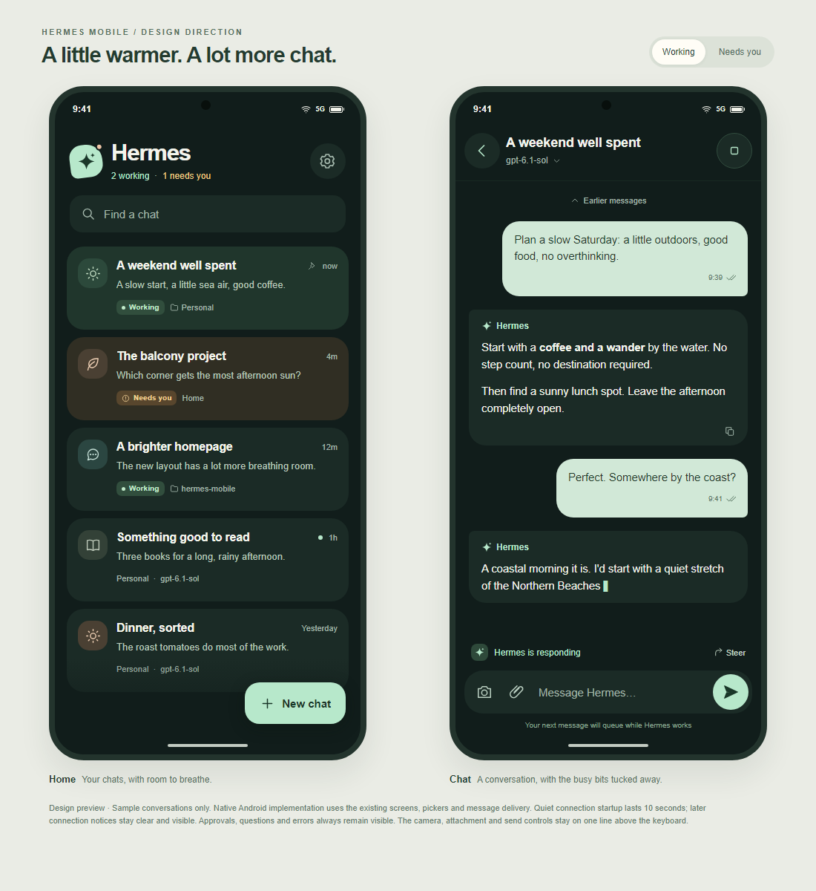

# Hermes Mobile

A native Android client for the Hermes Agent gateway. It connects over HTTPS/WSS and shares canonical sessions with Hermes Desktop, so a conversation can move between devices. This is a single-user, sideloaded project, developed against a particular gateway version; the upstream protocol can change.



The image is a design reference, not a promise of exact device appearance.

## Features

- Shared sessions, streaming responses, images, approvals and clarifications.
- Durable drafts and outbox, queue/steer/stop controls, reconnect and replay.
- Session search and filters, model and reasoning selection, and Android sharing into a reviewed draft.
- Foreground voice with transcript review or opt-in hands-free mode, and playback of completed replies.
- Local notifications and an optional separate PC-to-ntfy path.

Voice is foreground-only, transcribes completed recordings and waits for the final reply before speech playback. Android background delivery is best-effort; the optional ntfy path needs separate setup. See [status](docs/STATUS.md) for recorded acceptance gaps.

## Develop and build

Requirements: Node 24+, npm and Python 3. From the repository root:

```powershell
npm ci
npm run typecheck
npm run test:host
```

These are host checks; they do not test a phone or live gateway. Android builds additionally need a JDK and Android SDK. The [development guide](docs/development.md) covers Windows setup and `npm run android:preview`. The release-variant preview APK uses **debug signing**, not a production signing setup. Keep signing keys private and understand update identity before installing.

`npm run check:contract` compares against a separate local Hermes source checkout; it is not a clean-clone offline check. Live smoke tests require an explicitly configured gateway and credentials and can create or change test sessions. See [verification](docs/verification.md) before running them.

## Connect

Configure a compatible Hermes gateway with its authenticated Webapp listener and an HTTPS tailnet endpoint, for example `https://desktop.example-tailnet.ts.net:9120`. Set `HERMES_MOBILE_GATEWAY_URL` to your actual URL for the setup tools; set `HERMES_HOME` if your Hermes home is nonstandard. Follow [PC setup](PC_SETUP.md) and use `npm run setup:qr` to provision the phone. Never share the QR or token.

The deployment token grants powerful gateway access. Secure the gateway, tailnet and device, and keep credentials outside Git. Android SecureStore holds the connection credential; local SQLite drafts, history and outbox are not app-level encrypted. The PC must be awake and reachable.

## Documentation and contributions

The [documentation index](docs/README.md) links architecture, decisions, the governing [plan](PLAN.md), protocol observations, verification and release records. Historical evidence describes the original installation and does not establish behavior on yours. [Notifications](NOTIFICATIONS.md) describes both delivery tiers.

Issues and pull requests are welcome at [nushydude/hermes-mobile-android](https://github.com/nushydude/hermes-mobile-android). Read the [contributor guide](CONTRIBUTING.md) for local checks and contribution expectations. Report vulnerabilities using the [security policy](SECURITY.md); never post credentials or private conversation data.

Licensed under the [MIT License](LICENSE), with retained [third-party notices](THIRD_PARTY_NOTICES.md). This is an independent project, not an official Nous Research app.
