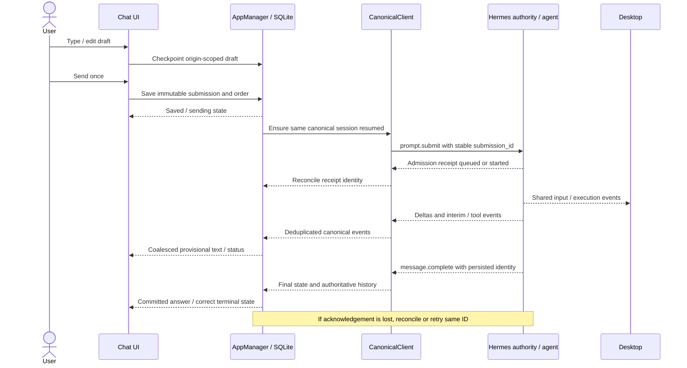
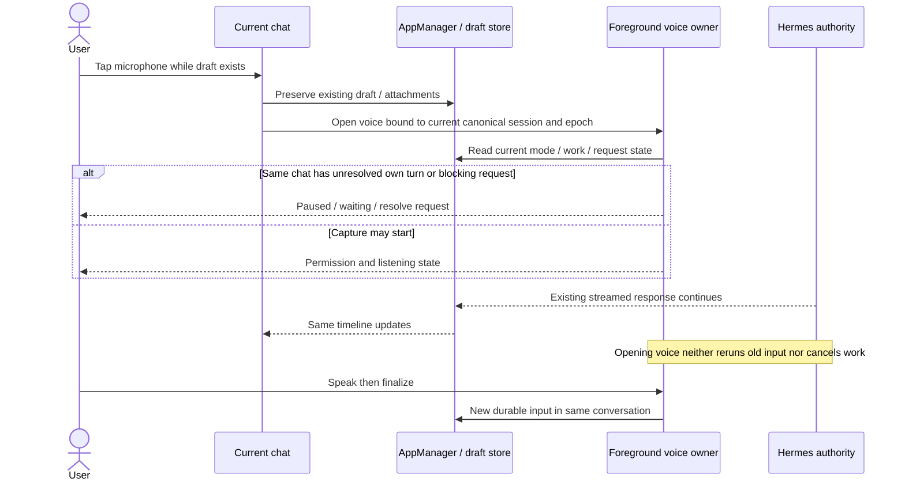
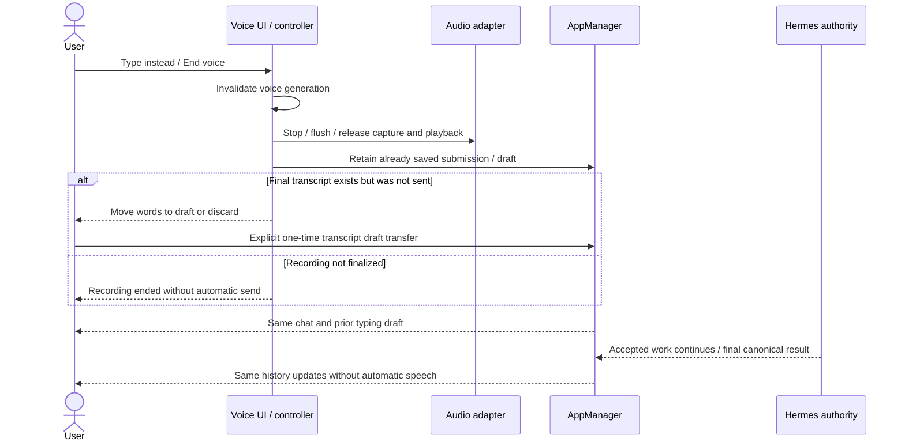
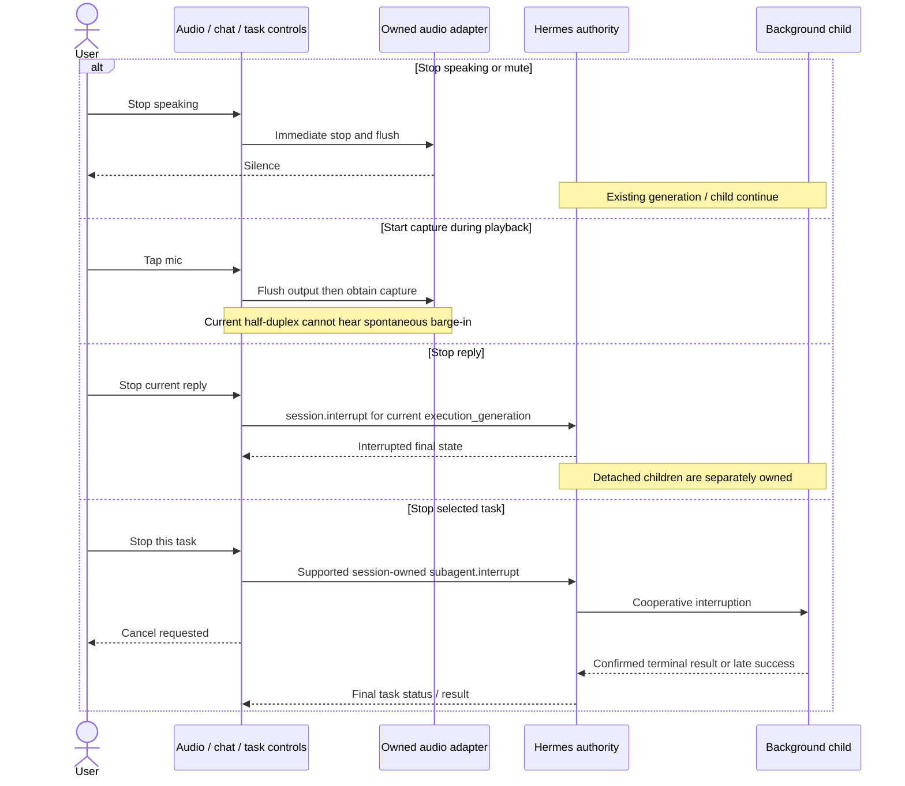
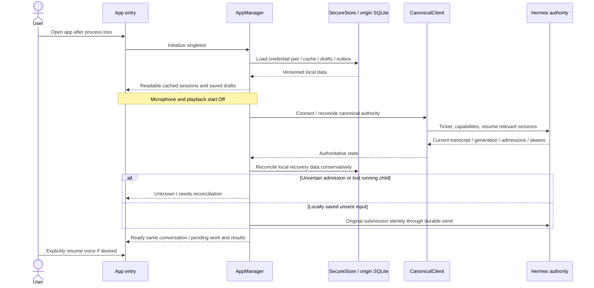

# Proposed unified conversation state and sequences

17 November 2026, Australia/Sydney. Proposed design revision 1; implementation not started. Companion to [sections 7–10 of the primary plan](../../HERMES_ANDROID_CONVERSATIONAL_EXPERIENCE_PLAN.md). This specifies intended behavior, not APIs already implemented. Existing invariants come from AppManager, CanonicalClient, VoiceController, VoiceCorrelation and VoicePlayback, listed in the [evidence inventory](2026-11-17-conversational-experience-evidence.md).

The [wireframe](conversational-experience-v1/wireframe.png) is an illustrative planning reference with synthetic content. It extends the current Warm Forest hierarchy without defining final visual assets. Existing [approved Warm Forest](../designs/warm-forest-v1/DESIGN.md) and [foreground voice](../designs/handsfree-v1/DESIGN.md) behavior remain the baseline unless a later accepted plan explicitly changes them.

The owner's later constraint is binding: existing Pro subscription/included API credits only, no new paid plans and no use beyond the free allowance. Before starting an API-dependent audio/agent operation, apply primary-plan section 14.0's allowance admission/reservation and no-paid-fallback gate. Low/exhausted or unverifiable allowance pauses the API path and offers the existing local/subscription fallback; it must never trigger credit purchases or lose/reexecute accepted canonical work.

## Orthogonal state model

Use independent axes; do not create a single giant state enum or a separate voice-session conversation.

| Axis | Proposed product states | Authority and persistence |
| --- | --- | --- |
| Transport | Offline, Connecting, Ready, Recovering, Auth failed, Incompatible | Existing CanonicalClient. Persist recovery data, not a claim the old socket is Ready. |
| Canonical input | Draft, Locally saved, Submitting, Admitted queued, Admitted started, Unknown, Settled | Existing durable submission/admission and authoritative snapshots. Never treat a transient RPC error as proof no prompt ran. |
| Foreground agent | Idle, Running, Needs input, Interrupt requested, Terminal | Hermes generation/requests/final status. Task execution is a different axis. |
| Input choice | Typing, Voice review, Voice hands-free | Device UI preference; selected canonical session is unchanged. |
| Capture | Off, Permission pending, Preparing, Calibrating, Listening, Speech, Ending, Transcribing, Review, Paused, Error | Voice resource owner. Current controller represents some states via its phase + VAD feedback. No capture resource survives background/process death. |
| Output preference | Text, Speak replies | Local explicit preference; independent of preset/input. A deliberate mute is not reset by opening the mic. |
| Playback | Idle, Preparing, Playing, Paused, Stopped, Finished, Failed, Intentionally skipped | Audio owner. Only a deliberate current automatic reply's Finished or Intentionally skipped outcome can trigger guarded next-listen. Stopped/stale/failed outcomes cannot. |
| Conversation policy | Actual custom/model+effort, Requested preset, Deferred preset, Confirm needed, Applied | Authority owns model/effort. Device maps to Fast/Balanced/Deep/Custom. Never claim a request changed current execution. |
| Background task | Requested, Running, Needs input, Cancel requested, Succeeded, Failed, Cancelled, Unknown; separate Result pending/Delivered | Hermes task/receipt/ledger. Phone cache is a projection. |

Persist per-origin/session draft, immutable input identity/order, attachments, admitted recovery references and user preferences using existing storage conventions. Do not persist transient Permission/Listening as a state to resume. For approved streaming STT, each utterance owns one provisional transcript revision plus a final value; provider item ordering cannot define canonical turn order.

## Transition guards and audio ownership

Every asynchronous continuation revalidates endpoint epoch, canonical session/alias, voice owner generation, foreground status, relevant admission/execution generation and cancellation signal. Resource acquisition after cancellation must release the acquired resource immediately. Native queues are bounded and stop/flush is local; network acknowledgements cannot delay silence.

| Trigger | State transition / action | Invariant |
| --- | --- | --- |
| Tap microphone | Stop owned playback, request permission, prepare capture | No automatic new session; no automatic cancellation of foreground/background agent work. |
| Permission denied | Capture Error/Off, provide Type instead and system-settings path when appropriate | No repeated automatic permission prompts or silent recording. |
| First meter samples | Calibration → Listening → Speech after thresholds | Display measured level, not fake recognized text. Missing/stale meter pauses hands-free. |
| Finish speaking / accepted endpoint | Ending → Transcribing → Review | One stop/finalization; no repeated upload from duplicate endpoint events. |
| Review Send / hands-free final | Locally saved → Submitting → Admitted | Final chosen words only; one stable submission ID checkpointed before transmission. |
| Final reply for another admission | Update shared chat only | Do not speak it or rearm this voice loop. |
| Matching final reply, Speak on | Prepare/play owned formatted final content | No tool commands/reasoning; canonical text unmodified. |
| Matching final reply, Speak off | Output Intentionally skipped | Automatic loop may rearm only if foreground/ready/no request/no unresolved own turn. |
| Mute while playing | Stop/flush local audio; output Text | Keep canonical answer and accepted work. Paused auto loop requires deliberate Resume unless a separately tested policy explicitly permits rearm. |
| Enable Speak during generation | Bind output to the currently owned turn's eventual final answer | No history replay or resubmit. During an already partly played final answer, explicit Read/replay avoids guessing where to resume. |
| Pause / focus loss / background | Capture/playback Paused or Off, release resources | No automatic listening after focus returns; no accidental natural-finish callback. |
| End voice / Type instead | Capture Off, playback Stopped; return same timeline | Do not interrupt agent. Transfer unsent final transcript to draft only by explicit action with stable transfer identity. |
| Transport not Ready / authority gap | Stop capture/audio, mark Paused | Cosmetic ten-second connection-banner grace cannot keep microphone/tool dispatch enabled. |
| Approval / clarify / secret request | Pause auto loop and show canonical request controls | Spoken “yes” never answers approval. |

Current speech is full-reply finality with chunked synthesis. An optional future immutable-speech event must have explicit canonical/admission/segment identity and finality semantics before it enters this state model. Punctuation is insufficient. Realtime/Live provider states and commands belong in separate adapters, not mixed with canonical JSON-RPC names.

## 1. Text conversation



Failure behavior: if checkpoint fails, retain the draft and do not silently send an untracked prompt. If admission is ambiguous, keep Unknown/recovery controls; do not mint another ID. A server tool error is shown as the authoritative turn result and cannot be repaired by re-adding a local assistant row.

## 2. Voice conversation

```mermaid
sequenceDiagram
    actor U as User
    participant V as VoiceController
    participant A as Audio adapter
    participant M as AppManager / outbox
    participant H as Hermes gateway / agent
    U->>V: Start review or hands-free in current chat
    V->>A: Obtain permission / stop old output / capture
    A-->>V: Meter and real capture duration
    U->>A: Speak
    V->>A: Stop once at Finish or accepted endpoint
    A->>H: File STT, or approved streaming STT plus EOS
    H-->>A: Final transcript for utterance
    A-->>V: Final recognized words
    alt Review first
        V-->>U: Edit / Send / Record again
        U->>V: Confirm final words
    else Explicit hands-free
        V->>V: Validate ready / foreground / no blocking request
    end
    V->>M: Durable submit; preserve typed draft
    M->>H: Same canonical prompt.submit path
    H-->>M: Admission and stream
    M-->>U: Text and tool status in same history
    H-->>M: Exactly matching final reply
    M-->>V: Correlated own final completion
    alt Speak replies enabled
        V->>A: Format completed answer / bounded synthesis
        A->>H: TTS section or validated PCM stream
        H-->>A: Audio
        A-->>U: Playback
        A-->>V: Natural finished outcome
    else Text output selected
        V->>V: Intentionally skipped output
    end
    V->>V: Guarded cooldown; rearm only if automatic and safe
```

Partial STT is a display-only provisional draft until finalization. File STT shows no partial words. No auto-rearm on foreign completion, user Stop, TTS failure, backgrounding, timeout or unresolved admission. Exactly matched final empty/error/interrupted output pauses hands-free and links to chat. Timing review dwell separately prevents pretending manual review is an engine bottleneck.

## 3. Switch text to voice



The mode chip and Speak replies remain independent. Do not automatically read an older unrelated answer just because the voice UI opened. If the current response was already bound to this user turn, future playback is explicit and correlation-preserving. Inputs while a turn is running use current queue/steer semantics; automatic voice capture should not collect another turn when its previous outcome is uncertain.

## 4. Switch voice to text



Draft transfer uses a stable local transfer ID, like the existing share import principle, and appends/preserves newer edits rather than replacing them silently. Do not auto-submit a partial recording while switching. Capture cleanup does not clear accepted input/outbox. Late STT/TTS callbacks are discarded by owner/epoch fencing.

## 5. User interruption



Optional native voice adds provider response cancellation/truncation or Live-specific controls after local silence, using that API's semantics. Never map all these branches to broad `/stop`. Interrupt does not roll back tool side effects; label partial results honestly. A background completion arriving during interruption cannot start new speech without user intent.

## 6. Network reconnection

```mermaid
sequenceDiagram
    participant A as Audio owner
    participant M as AppManager / cache
    participant C as CanonicalClient
    participant H as Hermes authority
    participant D as Desktop / ongoing work
    C-->>M: Connection lost / authority not ready
    M->>A: Pause and release local voice resources
    M->>M: Keep drafts / immutable outbox / receipts
    D->>H: Work may continue independently
    C->>H: Fresh authenticated ticket and dial
    H-->>C: gateway.ready / authority / replay epoch
    C->>H: Capabilities / described supported runtime
    C->>H: Existing per-session events.since / resume recovery
    alt Epoch changed or replay gap
        H-->>C: Snapshot required
        C->>H: Fresh resume / transcript reconciliation
    else Replay available
        H-->>C: Ordered deduplicated missing events
    end
    C-->>M: Canonical snapshot / receipts / aliases / tasks
    M->>H: Retry unresolved local submission only with original ID
    H-->>M: Same admission or authoritative unknown outcome
    M-->>A: Chat ready; voice remains paused
    Note over A,M: Explicit Resume, no replaying speech or automatic new task launch
```

The sequence names conceptual recovery steps; use the existing client's exact replay/resume algorithm rather than implementing a duplicate. Audio streams are not canonically replayable; do not splice old audio packets into a new owner. If provider media stays connected while Hermes binding is lost, stop audio/delegation anyway. Restored chat correctness takes precedence over cosmetic smoothness.

## 7. App restart and session restoration



If local storage initialization fails, retain the existing clear startup error; do not proceed with untracked sends. Endpoint credentials and cache must remain paired; an old operation cannot mutate a newly configured origin. Cache eviction does not authorize discarding unmatched saved text or draft-image recovery. Provider sessions, permission promises and native handles are never reconstructed from stale transient UI state.

## Acceptance and review contract

Use synthetic data in design/review packets. Test every async boundary with cancellation, endpoint/session change, foreground loss, duplicate events and late acquisition. Repeat both text/voice transition directions during idle, pending admission, generation and playback. Verify Desktop row/context equality after recovery, not just that both UIs display some text.

The primary plan defines device/performance/security/cost gates. These diagrams establish behavior; they do not certify runtime support, native playback quality, strict distributed exactly-once side effects or a production native-voice commit API. Save subsequent accepted revisions alongside the plan and supply the actual image and relevant contract text to zero-tool reviewers.
